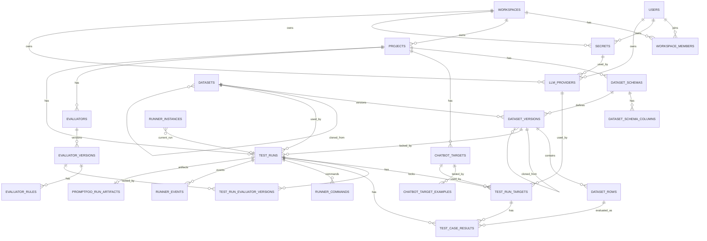

# VinFast QC Copilot — ERD Contract v0.1

## 1. Mục tiêu ERD v0.1

ERD v0.1 dùng để chốt logical data model cho MVP trước khi vẽ ERD hoặc sinh migration.

Mục tiêu chính:

```text id="ahw39f"
1. Đảm bảo backend database là source of truth.
2. Test run cũ không bị đổi nghĩa khi dataset/evaluator/config thay đổi.
3. Hỗ trợ single target run và comparison run bằng cùng một model.
4. Hỗ trợ Promptfoo Runner lấy locked run config từ backend.
5. Hỗ trợ realtime progress, result persistence, artifact metadata.
6. Hỗ trợ audit/idempotency cơ bản cho Redis Streams command/event.
```

---

## 2. Quyết định model v0.1

### 2.1. Dataset có version riêng

Thêm entity:

```text id="jhesmy"
DatasetVersion
```

Quan hệ mới:

```text id="kp0gdn"
Dataset 1 ── N DatasetVersion
DatasetVersion 1 ── N DatasetRow
```

Không để `DatasetRow` thuộc trực tiếp `Dataset` nữa.

Lý do:

```text id="whl7z6"
- Dataset có thể sửa sau import.
- TestRun phải lock chính xác data snapshot lúc chạy.
- Import từ project khác cần trace source version.
- Dashboard/result cũ không bị thay đổi nếu dataset mới bị sửa.
```

Rule:

```text id="p94sur"
- Import lần đầu tạo Dataset + DatasetVersion v1 + DatasetRows.
- Sửa row hoặc import lại tạo DatasetVersion mới.
- Không update trực tiếp row của version đã từng được dùng bởi TestRun.
- TestRun lock dataset_version_id.
```

---

### 2.2. EvaluatorRule thuộc EvaluatorVersion

Quan hệ mới:

```text id="w46rxw"
Evaluator 1 ── N EvaluatorVersion
EvaluatorVersion 1 ── N EvaluatorRule
```

Không để `EvaluatorRule` thuộc trực tiếp `Evaluator`.

Lý do:

```text id="gs3sd8"
- Rule đổi thì kết quả pass/fail có thể đổi.
- Rubric đổi thì score/judge reason có thể đổi.
- Comparison chỉ công bằng nếu dùng cùng evaluator version.
- TestRun cần lock evaluator version.
```

Rule:

```text id="mk5gwv"
- Đổi rule hoặc rubric tạo EvaluatorVersion mới.
- Không sửa rule của version đã từng được dùng bởi TestRun.
- TestRun dùng bảng join test_run_evaluator_versions để lock các evaluator versions.
```

---

### 2.3. ChatbotTargetExample là table riêng

Quan hệ mới:

```text id="yk193i"
ChatbotTarget 1 ── N ChatbotTargetExample
```

Lý do:

```text id="5r5a45"
- Cần lưu lịch sử test connection.
- QC có thể debug response thay đổi theo thời gian.
- Không ghi đè example cũ.
- ChatbotTarget vẫn giữ latest_example_id để preview nhanh.
```

Rule:

```text id="psdyxo"
- Mỗi lần test connection tạo một ChatbotTargetExample mới.
- ChatbotTarget.latest_example_id trỏ tới example mới nhất.
- response_extraction_config_json vẫn nằm ở ChatbotTarget vì đây là config đang dùng để chạy thật.
```

---

## 3. Entity list v0.1

### 3.1. Workspace & Access

```text id="klyd2n"
User
Workspace
WorkspaceMember
```

### 3.2. Secret & Provider

```text id="qlqqt2"
Secret
LLMProvider
```

### 3.3. Project & Target Config

```text id="f0jsc4"
Project
ChatbotTarget
ChatbotTargetExample
```

### 3.4. Dataset & Schema

```text id="qzlrkv"
DatasetSchema
DatasetSchemaColumn
Dataset
DatasetVersion
DatasetRow
DatasetImportJob
```

### 3.5. Evaluator

```text id="23p3x6"
Evaluator
EvaluatorVersion
EvaluatorRule
```

### 3.6. Execution & Result

```text id="qtgdtb"
TestRun
TestRunTarget
TestRunEvaluatorVersion
TestCaseResult
```

### 3.7. Runner / Queue / Artifact

```text id="0l4tio"
RunnerCommand
RunnerEvent
RunnerInstance
PromptfooRunArtifact
```

---

## 4. Relationship / Cardinality v0.1

### 4.1. Workspace & Project

```text id="k7qrx7"
User 1 ── N WorkspaceMember
Workspace 1 ── N WorkspaceMember
Workspace 1 ── N Project
```

Meaning:

```text id="mfwj6g"
- User tham gia workspace thông qua WorkspaceMember.
- MVP dùng workspace-level permission.
- Project luôn thuộc một workspace.
```

---

### 4.2. Secret & Provider

```text id="cgcc3e"
User 1 ── N Secret
Workspace 1 ── N Secret

User 1 ── N LLMProvider
Workspace 1 ── N LLMProvider
Secret 1 ── N LLMProvider
```

Meaning:

```text id="1zjxio"
- Secret có scope PERSONAL hoặc WORKSPACE.
- Provider có scope PERSONAL_PROVIDER hoặc WORKSPACE_PROVIDER.
- Provider có thể dùng cho LLM Judge hoặc baseline model.
```

---

### 4.3. Dataset & Schema

```text id="tr8xri"
Project 1 ── N DatasetSchema
DatasetSchema 1 ── N DatasetSchemaColumn

Dataset 1 ── N DatasetVersion
DatasetVersion 1 ── N DatasetRow

DatasetSchema 1 ── N DatasetVersion
DatasetImportJob 0/1 ── N DatasetVersion
Dataset 0/1 ── N Dataset
DatasetVersion 0/1 ── N DatasetVersion
```

Meaning:

```text id="4r6nvh"
- Dataset là logical container.
- DatasetVersion là snapshot của dataset tại một thời điểm.
- DatasetRow thuộc DatasetVersion.
- DatasetVersion lock schema_id + schema_version.
- Dataset có thể clone từ source_dataset_id.
- DatasetVersion có thể clone từ source_dataset_version_id.
```

---

### 4.4. Chatbot Target

```text id="wp3d6s"
Project 1 ── N ChatbotTarget
ChatbotTarget 1 ── N ChatbotTargetExample
ChatbotTarget 0/1 ── 1 ChatbotTargetExample as latest_example
```

Meaning:

```text id="7xjix9"
- ChatbotTarget lưu parsed cURL config.
- ChatbotTargetExample lưu lịch sử test connection.
- latest_example_id dùng để preview nhanh trên UI.
```

---

### 4.5. Evaluator

```text id="tgwyak"
Project 1 ── N Evaluator
Evaluator 1 ── N EvaluatorVersion
EvaluatorVersion 1 ── N EvaluatorRule
```

Meaning:

```text id="0n13lx"
- Evaluator là logical evaluator.
- EvaluatorVersion là snapshot version.
- EvaluatorRule thuộc version, không thuộc evaluator gốc.
```

---

### 4.6. Test Run & Result

```text id="k3tw7t"
Project 1 ── N TestRun
Dataset 1 ── N TestRun
DatasetVersion 1 ── N TestRun

TestRun 1 ── N TestRunTarget
TestRun 1 ── N TestRunEvaluatorVersion
EvaluatorVersion 1 ── N TestRunEvaluatorVersion

TestRun 1 ── N TestCaseResult
TestRunTarget 1 ── N TestCaseResult
DatasetRow 1 ── N TestCaseResult
```

Meaning:

```text id="xsd7vh"
- Single run có một TestRunTarget.
- Comparison run có nhiều TestRunTarget.
- Một dataset row có nhiều result nếu run có nhiều target.
- TestRun lock dataset_version_id và evaluator_version_id.
```

---

### 4.7. Runner / Queue / Artifact

```text id="uhwgtw"
TestRun 1 ── N RunnerCommand
TestRun 1 ── N RunnerEvent
RunnerInstance 0/1 ── 1 TestRun as current_test_run
TestRun 1 ── 0/1 PromptfooRunArtifact
```

Meaning:

```text id="exwo2i"
- RunnerCommand dùng cho idempotency/audit command stream.
- RunnerEvent dùng cho audit/process event stream.
- PromptfooRunArtifact lưu metadata path artifact.
```

---

## 5. Logical Tables v0.1

## 5.1. users

Ghi chú: nếu dùng auth provider ngoài, bảng này có thể là local user profile.

```text id="n8dt06"
id
email
name
avatar_url
status
created_at
updated_at
deleted_at
```

---

## 5.2. workspaces

```text id="k3j66h"
id
name
type                 -- PERSONAL | TEAM
created_by
created_at
updated_at
deleted_at
```

Constraints:

```text id="f0sp5h"
check type in (PERSONAL, TEAM)
index(created_by)
```

---

## 5.3. workspace_members

```text id="84wymu"
id
workspace_id
user_id
role                 -- OWNER | ADMIN | MEMBER | VIEWER
status               -- INVITED | ACTIVE | DISABLED
invited_by
joined_at
created_at
updated_at
```

Constraints:

```text id="ksqdc6"
unique(workspace_id, user_id)
index(user_id)
index(workspace_id, role)
```

---

## 5.4. secrets

```text id="6s5a74"
id
scope                -- PERSONAL | WORKSPACE
owner_user_id
workspace_id
name
encrypted_value
status               -- ACTIVE | DISABLED | DELETED
created_by
created_at
updated_at
deleted_at
```

Scope rule:

```text id="ddc14y"
PERSONAL:
  owner_user_id not null
  workspace_id null

WORKSPACE:
  workspace_id not null
  owner_user_id null
```

Constraints:

```text id="en5p26"
index(owner_user_id)
index(workspace_id)
unique(owner_user_id, name) where scope = PERSONAL and deleted_at is null
unique(workspace_id, name) where scope = WORKSPACE and deleted_at is null
```

---

## 5.5. llm_providers

```text id="lt20sl"
id
scope                  -- PERSONAL_PROVIDER | WORKSPACE_PROVIDER
owner_user_id
workspace_id
name
provider_type          -- OPENAI_COMPATIBLE | GEMINI | CLAUDE | CUSTOM_HTTP
secret_id
base_url
default_model
available_models_json
config_json
status                 -- ACTIVE | DISABLED | ERROR
created_by
created_at
updated_at
deleted_at
```

Scope rule:

```text id="7hwjnn"
PERSONAL_PROVIDER:
  owner_user_id not null
  workspace_id null

WORKSPACE_PROVIDER:
  workspace_id not null
  owner_user_id null
```

Constraints:

```text id="c8qd9k"
fk(secret_id) references secrets(id)
index(owner_user_id)
index(workspace_id)
index(secret_id)
```

---

## 5.6. projects

```text id="7amfk9"
id
workspace_id
name
description
created_by
created_at
updated_at
archived_at
deleted_at
```

Constraints:

```text id="nocn7q"
fk(workspace_id) references workspaces(id)
index(workspace_id)
unique(workspace_id, name) where deleted_at is null
```

---

## 5.7. dataset_schemas

```text id="xhx9ak"
id
project_id
version
name
created_by
created_at
```

Constraints:

```text id="rc0xpt"
fk(project_id) references projects(id)
unique(project_id, version)
index(project_id)
```

Rule:

```text id="hhb05d"
- Project mới tạo schema mặc định version 1.
- Nếu import Excel thêm cột mới, tạo schema version mới.
```

---

## 5.8. dataset_schema_columns

```text id="n41g7i"
id
schema_id
name
display_name
data_type             -- STRING | NUMBER | BOOLEAN | JSON | ARRAY | DATE | DATETIME
required
description
order_index
created_at
updated_at
```

Constraints:

```text id="c7ljdc"
fk(schema_id) references dataset_schemas(id)
unique(schema_id, name)
unique(schema_id, order_index)
index(schema_id)
```

---

## 5.9. datasets

```text id="i5xv2y"
id
scope                  -- PROJECT | WORKSPACE | PERSONAL
workspace_id
project_id
owner_user_id
current_version_id
name
description
source_dataset_id
source_project_id
source_workspace_id
source_type            -- EXCEL | PROJECT_CLONE | WORKSPACE_DATASET | PERSONAL_DATASET | MANUAL
created_by
created_at
updated_at
deleted_at
```

Scope rule:

```text id="y71dwd"
PROJECT:
  project_id not null

WORKSPACE:
  workspace_id not null
  project_id null

PERSONAL:
  owner_user_id not null
  workspace_id null
  project_id null
```

Constraints:

```text id="5qkt4a"
fk(workspace_id) references workspaces(id)
fk(project_id) references projects(id)
fk(owner_user_id) references users(id)
fk(source_dataset_id) references datasets(id)
fk(current_version_id) references dataset_versions(id) -- deferrable or added after dataset_versions exists

index(project_id)
index(workspace_id)
index(owner_user_id)
index(source_dataset_id)
```

Note:

```text id="br5dwu"
current_version_id giúp query dataset hiện tại nhanh.
Nếu muốn tránh circular FK ban đầu, có thể tạo column nullable trước rồi add FK sau.
```

---

## 5.10. dataset_versions

```text id="dlrs6z"
id
dataset_id
version
schema_id
schema_version
source_dataset_version_id
import_job_id
import_mapping_json
row_count
status                 -- DRAFT | ACTIVE | ARCHIVED
created_by
created_at
```

Constraints:

```text id="9t3rsl"
fk(dataset_id) references datasets(id)
fk(schema_id) references dataset_schemas(id)
fk(source_dataset_version_id) references dataset_versions(id)
fk(import_job_id) references dataset_import_jobs(id)

unique(dataset_id, version)
index(dataset_id)
index(schema_id)
index(source_dataset_version_id)
```

Rule:

```text id="kz0j8v"
- DatasetVersion là immutable sau khi ACTIVE.
- Sửa dataset tạo version mới.
- TestRun chỉ chạy trên ACTIVE DatasetVersion.
```

---

## 5.11. dataset_rows

```text id="e25w7b"
id
dataset_version_id
row_index
data_json
metadata_json
created_at
updated_at
```

Constraints:

```text id="g0n2x4"
fk(dataset_version_id) references dataset_versions(id)
unique(dataset_version_id, row_index)
index(dataset_version_id)
```

Rule:

```text id="l3ym3k"
- data_json chứa field theo schema tại dataset_version.schema_id/schema_version.
- Không update row của version đã ACTIVE và đã được TestRun dùng.
```

---

## 5.12. dataset_import_jobs

```text id="1hoorh"
id
target_project_id
target_dataset_id
source_type             -- EXCEL | PROJECT_CLONE | WORKSPACE_DATASET | PERSONAL_DATASET
source_file_id
source_dataset_id
source_dataset_version_id
status                  -- PENDING | PREVIEWED | IMPORTING | COMPLETED | FAILED | CANCELLED
mapping_json
preview_json
error_message
created_by
created_at
finished_at
```

Constraints:

```text id="gripbl"
fk(target_project_id) references projects(id)
fk(target_dataset_id) references datasets(id)
fk(source_dataset_id) references datasets(id)
fk(source_dataset_version_id) references dataset_versions(id)

index(target_project_id)
index(target_dataset_id)
index(status)
```

---

## 5.13. chatbot_targets

```text id="oygj6d"
id
project_id
name
description
raw_curl
method
url
headers_json
query_params_json
body_json
auth_config_json
dataset_mapping_json
latest_example_id
response_extraction_config_json
status                  -- DRAFT | ACTIVE | INVALID | DISABLED
created_by
created_at
updated_at
deleted_at
```

Constraints:

```text id="unhx7o"
fk(project_id) references projects(id)
fk(latest_example_id) references chatbot_target_examples(id)

unique(project_id, name) where deleted_at is null
index(project_id)
index(status)
```

Rule:

```text id="22eq38"
- Backend không shell-execute raw_curl.
- Backend dùng parsed fields khi chạy thật.
- latest_example_id nullable.
```

---

## 5.14. chatbot_target_examples

```text id="6ktabj"
id
chatbot_target_id
request_json
response_status_code
response_headers_json
response_body_json
extracted_output_json
latency_ms
error_message
tested_by
created_at
```

Constraints:

```text id="lylz3c"
fk(chatbot_target_id) references chatbot_targets(id)
fk(tested_by) references users(id)

index(chatbot_target_id, created_at)
index(tested_by)
```

Rule:

```text id="69vt94"
- Mỗi test connection tạo một row.
- Sensitive fields trong request/response phải được mask trước khi lưu.
```

---

## 5.15. evaluators

```text id="kz42zw"
id
project_id
name
type                   -- RULE_BASED | LLM_JUDGE | MIXED
created_by
created_at
updated_at
deleted_at
```

Constraints:

```text id="f6ic1e"
fk(project_id) references projects(id)
unique(project_id, name) where deleted_at is null
index(project_id)
```

---

## 5.16. evaluator_versions

```text id="1wndpo"
id
evaluator_id
version
config_json
created_by
created_at
```

Constraints:

```text id="9rwt5j"
fk(evaluator_id) references evaluators(id)
unique(evaluator_id, version)
index(evaluator_id)
```

Rule:

```text id="7obsx2"
- config_json chứa config tổng như rubric, threshold, score_scale, pass_condition, input_template, output_schema.
- Rule-based chi tiết có thể nằm ở evaluator_rules.
```

---

## 5.17. evaluator_rules

```text id="xzqtzi"
id
evaluator_version_id
field_source
operator
expected_value_json
weight
required
order_index
config_json
created_at
updated_at
```

Constraints:

```text id="69xnjz"
fk(evaluator_version_id) references evaluator_versions(id)
unique(evaluator_version_id, order_index)
index(evaluator_version_id)
```

Supported operator MVP:

```text id="0zpntk"
equals
not_equals
contains
not_contains
regex
exists
not_exists
is_empty
is_not_empty
greater_than
greater_than_or_equal
less_than
less_than_or_equal
is_json
contains_json
custom_javascript
```

Rule:

```text id="2gn2rp"
- Với LLM_JUDGE evaluator, evaluator_rules có thể rỗng.
- Với RULE_BASED evaluator, evaluator_rules chứa rule list.
- Với MIXED evaluator, evaluator_rules chứa rule-based part, config_json chứa LLM judge part.
```

---

## 5.18. test_runs

```text id="stgm7s"
id
project_id
run_type                  -- SINGLE | COMPARISON
dataset_id
dataset_version_id
dataset_schema_id
dataset_schema_version
judge_provider_id
judge_model
status                    -- PENDING | RUNNING | CANCELLING | CANCELLED | COMPLETED | FAILED
progress_completed
progress_total
summary_metrics_json
domain_config_snapshot_json
promptfoo_config_snapshot_json
started_by
started_at
finished_at
cancel_requested_at
created_at
updated_at
```

Constraints:

```text id="8fkoqo"
fk(project_id) references projects(id)
fk(dataset_id) references datasets(id)
fk(dataset_version_id) references dataset_versions(id)
fk(dataset_schema_id) references dataset_schemas(id)
fk(judge_provider_id) references llm_providers(id)
fk(started_by) references users(id)

index(project_id, created_at)
index(project_id, status)
index(dataset_version_id)
index(status)
```

Rule:

```text id="evx4pv"
- Mỗi lần rerun tạo TestRun mới.
- Không chuyển COMPLETED/FAILED/CANCELLED về RUNNING.
- Testcase fail do evaluator không làm TestRun FAILED.
- domain_config_snapshot_json lưu snapshot domain config đã lock.
- promptfoo_config_snapshot_json lưu generated config hoặc compact snapshot.
```

---

## 5.19. test_run_evaluator_versions

```text id="gkxw85"
id
test_run_id
evaluator_version_id
evaluator_type
order_index
created_at
```

Constraints:

```text id="3r5241"
fk(test_run_id) references test_runs(id)
fk(evaluator_version_id) references evaluator_versions(id)

unique(test_run_id, evaluator_version_id)
unique(test_run_id, order_index)
index(evaluator_version_id)
```

Rule:

```text id="4unx9x"
- Dùng bảng join thay cho evaluator_version_ids_json.
- Cho phép một run dùng nhiều evaluator version.
- Giữ thứ tự evaluator bằng order_index.
```

---

## 5.20. test_run_targets

```text id="2yavpw"
id
test_run_id
target_type               -- CHATBOT_TARGET | LLM_BASELINE
chatbot_target_id
llm_provider_id
model
display_name
provider_label
config_json
created_at
```

Constraints:

```text id="crko5m"
fk(test_run_id) references test_runs(id)
fk(chatbot_target_id) references chatbot_targets(id)
fk(llm_provider_id) references llm_providers(id)

index(test_run_id)
index(chatbot_target_id)
index(llm_provider_id)
```

Target rule:

```text id="jp7ysa"
CHATBOT_TARGET:
  chatbot_target_id not null
  llm_provider_id nullable
  model nullable

LLM_BASELINE:
  chatbot_target_id null
  llm_provider_id not null
  model not null
```

Run rule:

```text id="e5vol6"
SINGLE:
  exactly 1 test_run_target

COMPARISON:
  at least 2 test_run_targets
```

---

## 5.21. test_case_results

```text id="tel3pd"
id
test_run_id
test_run_target_id
dataset_row_id
input_vars_json
rendered_prompt
resolved_request_json
raw_response_json
extracted_output_json
grading_result_json
component_results_json
score
passed
latency_ms
token_usage_json
cost
error_message
created_at
```

Constraints:

```text id="uz32x7"
fk(test_run_id) references test_runs(id)
fk(test_run_target_id) references test_run_targets(id)
fk(dataset_row_id) references dataset_rows(id)

unique(test_run_id, test_run_target_id, dataset_row_id)
index(test_run_id)
index(test_run_target_id)
index(dataset_row_id)
index(passed)
```

Rule:

```text id="5ztmdy"
- Một dataset_row_id có nhiều result trong comparison run.
- raw_response_json và resolved_request_json phải được mask trước khi persist.
- grading_result_json chứa tổng result chấm.
- component_results_json chứa rule result, LLM judge reason, assertion breakdown.
```

---

## 5.22. runner_commands

```text id="se13zl"
id
command_id
test_run_id
command_type              -- START_RUN | CANCEL_RUN
stream_message_id
status                    -- PUBLISHED | CONSUMED | ACKED | FAILED | SKIPPED
attempt_count
created_at
acknowledged_at
```

Constraints:

```text id="n288o7"
fk(test_run_id) references test_runs(id)
unique(command_id)
index(test_run_id)
index(stream_message_id)
index(status)
```

Rule:

```text id="lj1u20"
- command_id + test_run_id là idempotency key ở application level.
- Duplicate START_RUN không tạo run mới.
```

---

## 5.23. runner_events

```text id="yy346z"
id
event_id
test_run_id
event_type
stream_message_id
payload_json
created_at
processed_at
```

Constraints:

```text id="o308dl"
fk(test_run_id) references test_runs(id)
unique(event_id)
index(test_run_id)
index(event_type)
index(stream_message_id)
index(processed_at)
```

Rule:

```text id="rp9a4j"
- Payload chứa normalized result compact.
- Không lưu artifact lớn trong runner_events.payload_json.
- Full artifact nằm trong local/object storage.
```

---

## 5.24. runner_instances

```text id="cmpjfm"
id
runner_id
status                  -- IDLE | RUNNING | OFFLINE | UNHEALTHY
current_test_run_id
last_heartbeat_at
created_at
updated_at
```

Constraints:

```text id="dc1akr"
unique(runner_id)
fk(current_test_run_id) references test_runs(id)
index(status)
index(last_heartbeat_at)
```

Rule:

```text id="x29l1n"
- Mỗi runner instance xử lý tối đa 1 test run tại một thời điểm.
- current_test_run_id nullable khi runner IDLE.
```

---

## 5.25. promptfoo_run_artifacts

```text id="9az5b8"
id
test_run_id
config_file_path
result_json_path
result_jsonl_path
html_report_path
logs_path
created_at
```

Constraints:

```text id="j03byd"
fk(test_run_id) references test_runs(id)
unique(test_run_id)
```

Rule:

```text id="gu2jd1"
- Artifact path chuẩn: ./storage/artifacts/test-runs/{testRunId}/
- Table chỉ lưu metadata/path.
- Không lưu file lớn trực tiếp trong DB.
```

---

# 6. Enum Contract v0.1

## 6.1. workspace_type

```text id="ndn1rg"
PERSONAL
TEAM
```

## 6.2. workspace_role

```text id="4pgkmu"
OWNER
ADMIN
MEMBER
VIEWER
```

## 6.3. secret_scope

```text id="4k9py4"
PERSONAL
WORKSPACE
```

## 6.4. provider_scope

```text id="dvt51h"
PERSONAL_PROVIDER
WORKSPACE_PROVIDER
```

## 6.5. provider_type

```text id="470oy2"
OPENAI_COMPATIBLE
GEMINI
CLAUDE
CUSTOM_HTTP
```

## 6.6. dataset_scope

```text id="6wxnii"
PROJECT
WORKSPACE
PERSONAL
```

## 6.7. evaluator_type

```text id="idd8ry"
RULE_BASED
LLM_JUDGE
MIXED
```

## 6.8. test_run_type

```text id="4nh2x2"
SINGLE
COMPARISON
```

## 6.9. test_run_status

```text id="6t66da"
PENDING
RUNNING
CANCELLING
CANCELLED
COMPLETED
FAILED
```

## 6.10. test_run_target_type

```text id="wyys44"
CHATBOT_TARGET
LLM_BASELINE
```

## 6.11. runner_command_type

```text id="i0944i"
START_RUN
CANCEL_RUN
```

## 6.12. runner_event_type

```text id="bmrj03"
RUN_STARTED
TESTCASE_STARTED
TESTCASE_COMPLETED
RUN_PROGRESS
RUN_COMPLETED
RUN_FAILED
RUN_CANCELLED
```

---

# 7. Important Invariants v0.1

## 7.1. TestRun locking invariant

Khi tạo TestRun, backend phải lock:

```text id="xerehh"
- dataset_id
- dataset_version_id
- dataset_schema_id
- dataset_schema_version
- evaluator_version_id list
- judge_provider_id
- judge_model
- test_run_targets
- domain_config_snapshot_json
```

Không lấy config mutable trực tiếp lúc runner chạy.

---

## 7.2. Dataset immutability invariant

```text id="wivph9"
DatasetVersion ACTIVE không được update rows trực tiếp nếu đã có TestRun dùng.
```

Muốn sửa dataset:

```text id="a3wc13"
Create DatasetVersion mới.
```

---

## 7.3. Evaluator immutability invariant

```text id="4x68ff"
EvaluatorVersion không được update nếu đã có TestRunEvaluatorVersion trỏ tới.
```

Muốn sửa evaluator:

```text id="ojzemq"
Create EvaluatorVersion mới.
```

---

## 7.4. Comparison fairness invariant

Trong cùng một comparison run, tất cả target phải dùng chung:

```text id="2y2wd2"
- dataset_version_id
- dataset_schema_version
- evaluator versions
- judge_provider_id
- judge_model
- run config snapshot
```

Chỉ khác:

```text id="vxamsm"
- target chatbot/model/provider
```

---

## 7.5. Result uniqueness invariant

```text id="77ootm"
Mỗi test_run_target chỉ có tối đa một result cho một dataset_row.
```

Enforced by:

```text id="unmr1m"
unique(test_run_id, test_run_target_id, dataset_row_id)
```

---

## 7.6. Runner idempotency invariant

```text id="ta0spv"
Duplicate START_RUN không được tạo duplicate execution.
```

Enforced by:

```text id="ovt3b6"
runner_commands.command_id unique
application check command_id + test_run_id
test_run.status state machine
```

---

# 8. Delete / Archive Policy v0.1

## 8.1. Soft delete

Dùng `deleted_at` cho:

```text id="xspmim"
workspaces
projects
secrets
llm_providers
datasets
chatbot_targets
evaluators
```

## 8.2. Không xóa cứng execution data

Không xóa cứng mặc định:

```text id="dg0qc9"
test_runs
test_run_targets
test_case_results
runner_commands
runner_events
promptfoo_run_artifacts
```

Lý do:

```text id="s61sl3"
- Cần audit/debug.
- Dashboard run cũ cần ổn định.
- Artifact path cần trace được.
```

## 8.3. Dataset/evaluator version không xóa cứng

Không xóa cứng:

```text id="f3igqy"
dataset_versions
dataset_rows
evaluator_versions
evaluator_rules
```

Nếu cần ẩn thì dùng status:

```text id="igkxww"
ARCHIVED
```

---

# 9. ERD v0.1 Mermaid Draft



---

# 10. ERD Review Checklist

Trước khi vẽ final ERD hoặc sinh migration, kiểm tra 8 flow này:

```text id="v8lpba"
1. User tạo team workspace, invite member.
2. Admin tạo workspace secret/provider.
3. QC tạo project, hệ thống tạo schema mặc định.
4. QC paste cURL, test connection nhiều lần, lưu lịch sử examples.
5. QC import Excel, tạo dataset version v1.
6. QC sửa dataset, tạo dataset version v2.
7. QC sửa evaluator rule, tạo evaluator version mới.
8. QC chạy comparison, mỗi target có result riêng cho cùng dataset row.
```

Nếu 8 flow này chạy được trên ERD mà không cần hack JSON hoặc FK lỏng lẻo, ERD v0.1 đạt yêu cầu.

