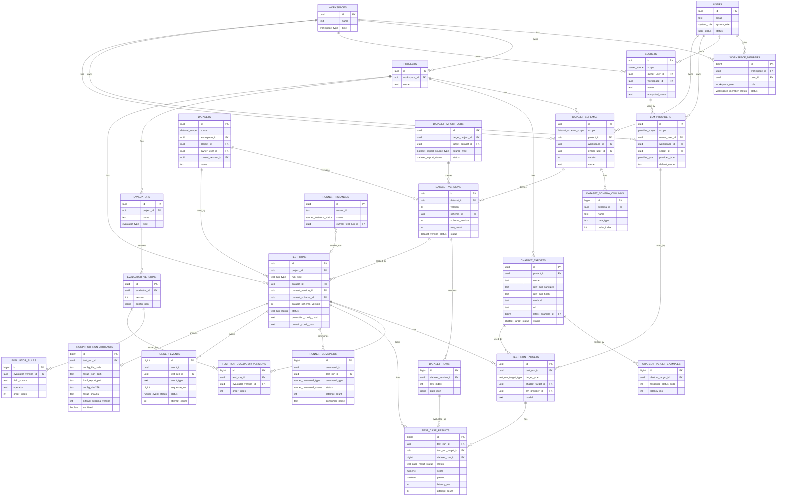

# VinFast QC Copilot — ERD Contract v0.3

## 1. Mục tiêu v0.3

ERD v0.3 là bản logical database contract cho PostgreSQL, đồng bộ với PRD v0.5.

So với v0.2, bản v0.3 chốt thêm:

```text
1. Sửa dataset_schemas sang scope-aware model: PROJECT / WORKSPACE / PERSONAL.
2. Thêm dataset_schema_scope enum.
3. Thêm test_case_result_status enum.
4. Thêm test_case_results.status, started_at, finished_at, attempt_count.
5. Thêm runner_event_status enum.
6. Bổ sung lifecycle fields cho runner_events: sequence_no, status, attempt_count, last_error, consumer_name, acknowledged_at, dlq_at.
7. Bổ sung lifecycle fields cho runner_commands: last_error, consumer_name, published_at, consumed_at, failed_at, dlq_at.
8. Sửa test_runs để promptfoo_config_snapshot_json là sanitized compact snapshot only.
9. Thêm test_runs.promptfoo_config_hash và test_runs.domain_config_hash.
10. Sửa chatbot_targets raw_curl thành raw_curl_sanitized + raw_curl_hash.
11. Bổ sung artifact audit fields: config_sha256, result_sha256, artifact_schema_version, sanitized.
12. Đồng bộ security rule: không lưu raw cURL/plain secret trong DB/artifact.
```

---

# 2. Permission Model v0.3

## 2.1. Hai tầng role

Hệ thống có 2 tầng role độc lập:

```text id="p8fyo3"
1. System role:
   users.system_role

2. Workspace role:
   workspace_members.role
```

## 2.2. System role

```text id="z0gjpb"
users.system_role:
- PLATFORM_ADMIN
- USER
```

Ý nghĩa:

```text id="pf41nw"
PLATFORM_ADMIN:
- Admin toàn platform.
- Có gần như mọi quyền vận hành trên hệ thống.
- Có thể quản lý users, workspaces, projects, configs, runs.
- Có thể can thiệp workspace mà không cần là workspace member.

USER:
- User bình thường.
- Quyền phụ thuộc vào workspace_members.role trong từng workspace.
```

## 2.3. Workspace role

```text id="b6xbyk"
workspace_members.role:
- OWNER
- ADMIN
- MEMBER
- VIEWER
```

Ý nghĩa:

```text id="by64ai"
OWNER:
- Chủ workspace.
- Có quyền cao nhất trong workspace.
- Có thể đổi role member.
- Có thể xóa/archive workspace nếu policy cho phép.

ADMIN:
- Quản trị workspace.
- Có thể cấu hình workspace/project/dataset/evaluator/run.
- Có thể invite và đổi role member theo permission matrix.

MEMBER:
- QC member thông thường.
- Có thể tạo/sửa project, import dataset, cấu hình target/evaluator, chạy test.

VIEWER:
- Chỉ xem workspace/project/dashboard/result.
```

## 2.4. Permission resolver

Rule tổng quát:

```text id="90a6uv"
1. Nếu action là xem lại plain text secret:
   DENY cho mọi role, kể cả PLATFORM_ADMIN.

2. Nếu users.system_role = PLATFORM_ADMIN:
   ALLOW gần như mọi action còn lại.

3. Nếu users.system_role = USER:
   Check workspace_members.role.

4. Nếu user không phải member workspace:
   DENY.
```

Pseudo-code:

```java id="f2lr1u"
boolean canPerform(User user, UUID workspaceId, Action action) {
    if (action == Action.READ_PLAINTEXT_SECRET) {
        return false;
    }

    if (user.systemRole == SystemRole.PLATFORM_ADMIN) {
        return true;
    }

    WorkspaceMember member = findActiveWorkspaceMember(workspaceId, user.id);

    if (member == null) {
        return false;
    }

    return workspacePermissionMatrix.allows(member.role, action);
}
```

---

# 3. PostgreSQL ID Strategy v0.3

## 3.1. Rule chọn ID

```text id="3nn5o5"
Dùng UUID cho:
- Entity chính.
- Resource expose qua API/URL/frontend.
- Entity đi qua Redis command/event.
- Entity cần tránh ID dễ đoán.

Dùng BIGINT cho:
- Child/detail table.
- Join table.
- High-volume table.
- Table ít hoặc không expose trực tiếp ra API.
```

## 3.2. UUID tables

```text id="fn2p5s"
users
workspaces
projects

secrets
llm_providers

dataset_schemas
datasets
dataset_versions
dataset_import_jobs

chatbot_targets

evaluators
evaluator_versions

test_runs
test_run_targets

runner_instances
```

## 3.3. BIGINT tables

```text id="je525l"
workspace_members

dataset_schema_columns
dataset_rows

chatbot_target_examples

evaluator_rules

test_run_evaluator_versions
test_case_results

runner_commands
runner_events

promptfoo_run_artifacts
```

## 3.4. PostgreSQL UUID default

```sql id="ywmp90"
CREATE EXTENSION IF NOT EXISTS pgcrypto;

id UUID PRIMARY KEY DEFAULT gen_random_uuid()
```

## 3.5. PostgreSQL BIGINT identity

```sql id="5hmwh1"
id BIGINT GENERATED BY DEFAULT AS IDENTITY PRIMARY KEY
```

---

# 4. Entity List v0.3

## 4.1. Access & Workspace

```text id="pxpnkc"
User
Workspace
WorkspaceMember
```

## 4.2. Secret & Provider

```text id="s88s26"
Secret
LLMProvider
```

## 4.3. Project & Target

```text id="eiw5ad"
Project
ChatbotTarget
ChatbotTargetExample
```

## 4.4. Dataset

```text id="u1hvgo"
DatasetSchema
DatasetSchemaColumn
Dataset
DatasetVersion
DatasetRow
DatasetImportJob
```

## 4.5. Evaluator

```text id="qqlykf"
Evaluator
EvaluatorVersion
EvaluatorRule
```

## 4.6. Execution

```text id="dcoq7n"
TestRun
TestRunTarget
TestRunEvaluatorVersion
TestCaseResult
```

## 4.7. Runner & Artifact

```text id="u8ffg0"
RunnerCommand
RunnerEvent
RunnerInstance
PromptfooRunArtifact
```

---

# 5. Relationship / Cardinality v0.3

## 5.1. Workspace

```text id="zc8r85"
User 1 ── N WorkspaceMember
Workspace 1 ── N WorkspaceMember
Workspace 1 ── N Project
```

## 5.2. Secret & Provider

```text id="dc8xu3"
User 1 ── N Secret
Workspace 1 ── N Secret

User 1 ── N LLMProvider
Workspace 1 ── N LLMProvider
Secret 1 ── N LLMProvider
```

## 5.3. Dataset

```text
Project 0/1 ── N DatasetSchema
Workspace 0/1 ── N DatasetSchema
User 0/1 ── N DatasetSchema as owner_user
DatasetSchema 1 ── N DatasetSchemaColumn

Dataset 1 ── N DatasetVersion
DatasetSchema 1 ── N DatasetVersion
DatasetVersion 1 ── N DatasetRow

Dataset 0/1 ── N Dataset as source_dataset
DatasetVersion 0/1 ── N DatasetVersion as source_dataset_version
DatasetImportJob 0/1 ── N DatasetVersion
```

Schema scope rule:

```text
PROJECT schema thuộc project.
WORKSPACE schema thuộc workspace.
PERSONAL schema thuộc user.
```

---

## 5.4. Chatbot Target

```text id="v4x17m"
Project 1 ── N ChatbotTarget
ChatbotTarget 1 ── N ChatbotTargetExample
ChatbotTarget 0/1 ── 1 ChatbotTargetExample as latest_example
```

## 5.5. Evaluator

```text id="hxy7dq"
Project 1 ── N Evaluator
Evaluator 1 ── N EvaluatorVersion
EvaluatorVersion 1 ── N EvaluatorRule
```

## 5.6. Test Run

```text id="we2xre"
Project 1 ── N TestRun
Dataset 1 ── N TestRun
DatasetVersion 1 ── N TestRun

TestRun 1 ── N TestRunTarget
TestRun 1 ── N TestRunEvaluatorVersion
EvaluatorVersion 1 ── N TestRunEvaluatorVersion

TestRun 1 ── N TestCaseResult
TestRunTarget 1 ── N TestCaseResult
DatasetRow 1 ── N TestCaseResult
```

## 5.7. Runner & Artifact

```text id="n573uc"
TestRun 1 ── N RunnerCommand
TestRun 1 ── N RunnerEvent
RunnerInstance 0/1 ── 1 TestRun as current_test_run
TestRun 1 ── 0/1 PromptfooRunArtifact
```

---

# 6. PostgreSQL Enums v0.3

```sql id="tf0r3k"
CREATE TYPE system_role AS ENUM (
  'PLATFORM_ADMIN',
  'USER'
);

CREATE TYPE user_status AS ENUM (
  'ACTIVE',
  'DISABLED',
  'DELETED'
);

CREATE TYPE workspace_type AS ENUM (
  'PERSONAL',
  'TEAM'
);

CREATE TYPE workspace_role AS ENUM (
  'OWNER',
  'ADMIN',
  'MEMBER',
  'VIEWER'
);

CREATE TYPE workspace_member_status AS ENUM (
  'INVITED',
  'ACTIVE',
  'DISABLED'
);

CREATE TYPE secret_scope AS ENUM (
  'PERSONAL',
  'WORKSPACE'
);

CREATE TYPE secret_status AS ENUM (
  'ACTIVE',
  'DISABLED',
  'DELETED'
);

CREATE TYPE provider_scope AS ENUM (
  'PERSONAL_PROVIDER',
  'WORKSPACE_PROVIDER'
);

CREATE TYPE provider_type AS ENUM (
  'OPENAI_COMPATIBLE',
  'GEMINI',
  'CLAUDE',
  'CUSTOM_HTTP'
);

CREATE TYPE provider_status AS ENUM (
  'ACTIVE',
  'DISABLED',
  'ERROR'
);

CREATE TYPE dataset_schema_scope AS ENUM (
  'PROJECT',
  'WORKSPACE',
  'PERSONAL'
);

CREATE TYPE dataset_scope AS ENUM (
  'PROJECT',
  'WORKSPACE',
  'PERSONAL'
);

CREATE TYPE dataset_source_type AS ENUM (
  'EXCEL',
  'PROJECT_CLONE',
  'WORKSPACE_DATASET',
  'PERSONAL_DATASET',
  'MANUAL'
);

CREATE TYPE dataset_version_status AS ENUM (
  'DRAFT',
  'ACTIVE',
  'ARCHIVED'
);

CREATE TYPE dataset_import_source_type AS ENUM (
  'EXCEL',
  'PROJECT_CLONE',
  'WORKSPACE_DATASET',
  'PERSONAL_DATASET'
);

CREATE TYPE dataset_import_status AS ENUM (
  'PENDING',
  'PREVIEWED',
  'IMPORTING',
  'COMPLETED',
  'FAILED',
  'CANCELLED'
);

CREATE TYPE chatbot_target_status AS ENUM (
  'DRAFT',
  'ACTIVE',
  'INVALID',
  'DISABLED'
);

CREATE TYPE evaluator_type AS ENUM (
  'RULE_BASED',
  'LLM_JUDGE',
  'MIXED'
);

CREATE TYPE test_run_type AS ENUM (
  'SINGLE',
  'COMPARISON'
);

CREATE TYPE test_run_status AS ENUM (
  'PENDING',
  'RUNNING',
  'CANCELLING',
  'CANCELLED',
  'COMPLETED',
  'FAILED'
);

CREATE TYPE test_run_target_type AS ENUM (
  'CHATBOT_TARGET',
  'LLM_BASELINE'
);


CREATE TYPE test_case_result_status AS ENUM (
  'PASSED',
  'FAILED',
  'ERROR',
  'JUDGE_ERROR',
  'TIMEOUT',
  'SKIPPED',
  'CANCELLED'
);

CREATE TYPE runner_event_status AS ENUM (
  'PUBLISHED',
  'PROCESSING',
  'PROCESSED',
  'FAILED',
  'DLQ',
  'SKIPPED'
);

CREATE TYPE runner_command_type AS ENUM (
  'START_RUN',
  'CANCEL_RUN'
);

CREATE TYPE runner_command_status AS ENUM (
  'PUBLISHED',
  'CONSUMED',
  'ACKED',
  'FAILED',
  'SKIPPED'
);

CREATE TYPE runner_instance_status AS ENUM (
  'IDLE',
  'RUNNING',
  'OFFLINE',
  'UNHEALTHY'
);
```

Ghi chú:

```text id="z8v41c"
runner_events.event_type có thể dùng TEXT ở v0.3 để dễ thêm event mới mà không cần migration enum liên tục.
```

---

# 7. Logical Tables v0.3

## 7.1. users

ID type: `UUID`

```text id="p9ukw6"
id UUID PK
email TEXT NOT NULL
name TEXT
avatar_url TEXT
system_role system_role NOT NULL DEFAULT 'USER'
status user_status NOT NULL DEFAULT 'ACTIVE'
created_at TIMESTAMPTZ NOT NULL
updated_at TIMESTAMPTZ NOT NULL
deleted_at TIMESTAMPTZ
```

Constraints:

```text id="uazevw"
unique(email)
index(system_role)
index(status)
```

---

## 7.2. workspaces

ID type: `UUID`

```text id="z28mib"
id UUID PK
name TEXT NOT NULL
type workspace_type NOT NULL
created_by UUID FK users(id)
created_at TIMESTAMPTZ NOT NULL
updated_at TIMESTAMPTZ NOT NULL
deleted_at TIMESTAMPTZ
```

Constraints:

```text id="x6rktv"
index(created_by)
index(type)
```

Rule:

```text id="mmt529"
- User mới tạo personal workspace tự động.
- Người tạo workspace được insert vào workspace_members với role OWNER.
```

---

## 7.3. workspace_members

ID type: `BIGINT`

```text id="vajjjm"
id BIGINT PK
workspace_id UUID FK workspaces(id)
user_id UUID FK users(id)
role workspace_role NOT NULL
status workspace_member_status NOT NULL
invited_by UUID FK users(id)
joined_at TIMESTAMPTZ
created_at TIMESTAMPTZ NOT NULL
updated_at TIMESTAMPTZ NOT NULL
```

Constraints:

```text id="s4uc1b"
unique(workspace_id, user_id)
index(user_id)
index(workspace_id, role)
index(workspace_id, status)
```

---

## 7.4. secrets

ID type: `UUID`

```text id="gk8ec9"
id UUID PK
scope secret_scope NOT NULL
owner_user_id UUID FK users(id)
workspace_id UUID FK workspaces(id)
name TEXT NOT NULL
encrypted_value TEXT NOT NULL
status secret_status NOT NULL
created_by UUID FK users(id)
created_at TIMESTAMPTZ NOT NULL
updated_at TIMESTAMPTZ NOT NULL
deleted_at TIMESTAMPTZ
```

Scope rule:

```text id="oozxi5"
PERSONAL:
  owner_user_id NOT NULL
  workspace_id NULL

WORKSPACE:
  workspace_id NOT NULL
  owner_user_id NULL
```

Constraints:

```text id="jp4bd8"
index(owner_user_id)
index(workspace_id)
index(created_by)

unique(owner_user_id, name) where scope = 'PERSONAL' and deleted_at is null
unique(workspace_id, name) where scope = 'WORKSPACE' and deleted_at is null
```

Security rule:

```text id="cxzmem"
Không role nào được xem lại plain text secret sau khi lưu, kể cả PLATFORM_ADMIN.
```

---

## 7.5. llm_providers

ID type: `UUID`

```text id="o2cwu4"
id UUID PK
scope provider_scope NOT NULL
owner_user_id UUID FK users(id)
workspace_id UUID FK workspaces(id)
name TEXT NOT NULL
provider_type provider_type NOT NULL
secret_id UUID FK secrets(id)
base_url TEXT
default_model TEXT
available_models_json JSONB
config_json JSONB
status provider_status NOT NULL
created_by UUID FK users(id)
created_at TIMESTAMPTZ NOT NULL
updated_at TIMESTAMPTZ NOT NULL
deleted_at TIMESTAMPTZ
```

Constraints:

```text id="sse8ko"
index(owner_user_id)
index(workspace_id)
index(secret_id)
index(provider_type)
index(status)
```

---

## 7.6. projects

ID type: `UUID`

```text id="z51sjv"
id UUID PK
workspace_id UUID FK workspaces(id)
name TEXT NOT NULL
description TEXT
created_by UUID FK users(id)
created_at TIMESTAMPTZ NOT NULL
updated_at TIMESTAMPTZ NOT NULL
archived_at TIMESTAMPTZ
deleted_at TIMESTAMPTZ
```

Constraints:

```text id="zjqbdj"
index(workspace_id)
index(created_by)
unique(workspace_id, name) where deleted_at is null
```

---

## 7.7. dataset_schemas

ID type: `UUID`

```text
id UUID PK
scope dataset_schema_scope NOT NULL
project_id UUID FK projects(id)
workspace_id UUID FK workspaces(id)
owner_user_id UUID FK users(id)
version INT NOT NULL
name TEXT NOT NULL
created_by UUID FK users(id)
created_at TIMESTAMPTZ NOT NULL
```

Scope rule:

```text
PROJECT:
  project_id NOT NULL
  workspace_id NULL
  owner_user_id NULL

WORKSPACE:
  workspace_id NOT NULL
  project_id NULL
  owner_user_id NULL

PERSONAL:
  owner_user_id NOT NULL
  workspace_id NULL
  project_id NULL
```

Constraints:

```text
unique(project_id, version) where scope = 'PROJECT'
unique(workspace_id, name, version) where scope = 'WORKSPACE'
unique(owner_user_id, name, version) where scope = 'PERSONAL'
index(project_id)
index(workspace_id)
index(owner_user_id)
index(scope)
```

Rule:

```text
- Project mới tạo schema mặc định scope PROJECT: question, expected.
- Workspace/personal dataset độc lập tạo schema theo đúng scope.
- Nếu import thêm cột mới, tạo schema version mới trong target scope.
```

---

## 7.8. dataset_schema_columns

ID type: `BIGINT`

```text id="x1hjb5"
id BIGINT PK
schema_id UUID FK dataset_schemas(id)
name TEXT NOT NULL
display_name TEXT
data_type TEXT NOT NULL
required BOOLEAN NOT NULL DEFAULT false
description TEXT
order_index INT NOT NULL
created_at TIMESTAMPTZ NOT NULL
updated_at TIMESTAMPTZ NOT NULL
```

Constraints:

```text id="qwfh3v"
unique(schema_id, name)
unique(schema_id, order_index)
index(schema_id)
```

---

## 7.9. datasets

ID type: `UUID`

```text id="j35uwi"
id UUID PK
scope dataset_scope NOT NULL
workspace_id UUID FK workspaces(id)
project_id UUID FK projects(id)
owner_user_id UUID FK users(id)
current_version_id UUID FK dataset_versions(id)
name TEXT NOT NULL
description TEXT
source_dataset_id UUID FK datasets(id)
source_project_id UUID FK projects(id)
source_workspace_id UUID FK workspaces(id)
source_type dataset_source_type
created_by UUID FK users(id)
created_at TIMESTAMPTZ NOT NULL
updated_at TIMESTAMPTZ NOT NULL
deleted_at TIMESTAMPTZ
```

Scope rule:

```text id="m5977z"
PROJECT:
  project_id NOT NULL

WORKSPACE:
  workspace_id NOT NULL
  project_id NULL

PERSONAL:
  owner_user_id NOT NULL
  workspace_id NULL
  project_id NULL
```

Constraints:

```text id="d4xhwu"
index(project_id)
index(workspace_id)
index(owner_user_id)
index(source_dataset_id)
index(current_version_id)
```

Implementation note:

```text id="z0l8lh"
current_version_id tạo circular FK với dataset_versions.
Khi migration, có thể:
1. Tạo datasets chưa có FK current_version_id.
2. Tạo dataset_versions.
3. ALTER TABLE datasets ADD CONSTRAINT FK current_version_id.
```

---

## 7.10. dataset_versions

ID type: `UUID`

```text id="u9z2v5"
id UUID PK
dataset_id UUID FK datasets(id)
version INT NOT NULL
schema_id UUID FK dataset_schemas(id)
schema_version INT NOT NULL
source_dataset_version_id UUID FK dataset_versions(id)
import_job_id UUID FK dataset_import_jobs(id)
import_mapping_json JSONB
row_count INT NOT NULL DEFAULT 0
status dataset_version_status NOT NULL DEFAULT 'DRAFT'
created_by UUID FK users(id)
created_at TIMESTAMPTZ NOT NULL
```

Constraints:

```text id="n5b60s"
unique(dataset_id, version)
index(dataset_id)
index(schema_id)
index(source_dataset_version_id)
index(import_job_id)
index(status)
```

Rule:

```text id="bo3ewg"
- DatasetVersion ACTIVE là immutable.
- Sửa dataset tạo version mới.
- TestRun lock dataset_version_id.
```

---

## 7.11. dataset_rows

ID type: `BIGINT`

```text id="f96iqt"
id BIGINT PK
dataset_version_id UUID FK dataset_versions(id)
row_index INT NOT NULL
data_json JSONB NOT NULL
metadata_json JSONB
created_at TIMESTAMPTZ NOT NULL
updated_at TIMESTAMPTZ NOT NULL
```

Constraints:

```text id="a85q7j"
unique(dataset_version_id, row_index)
index(dataset_version_id)
```

Rule:

```text id="aqx2r6"
- Không update row thuộc DatasetVersion ACTIVE đã được TestRun dùng.
- Nếu cần sửa data, tạo DatasetVersion mới.
```

---

## 7.12. dataset_import_jobs

ID type: `UUID`

```text id="em7w0i"
id UUID PK
target_project_id UUID FK projects(id)
target_dataset_id UUID FK datasets(id)
source_type dataset_import_source_type NOT NULL
source_file_id TEXT
source_dataset_id UUID FK datasets(id)
source_dataset_version_id UUID FK dataset_versions(id)
status dataset_import_status NOT NULL
mapping_json JSONB
preview_json JSONB
error_message TEXT
created_by UUID FK users(id)
created_at TIMESTAMPTZ NOT NULL
finished_at TIMESTAMPTZ
```

Constraints:

```text id="aid4b3"
index(target_project_id)
index(target_dataset_id)
index(source_dataset_id)
index(source_dataset_version_id)
index(status)
```

---

## 7.13. chatbot_targets

ID type: `UUID`

```text
id UUID PK
project_id UUID FK projects(id)
name TEXT NOT NULL
description TEXT
raw_curl_sanitized TEXT
raw_curl_hash TEXT
method TEXT NOT NULL
url TEXT NOT NULL
headers_json JSONB
query_params_json JSONB
body_json JSONB
auth_config_json JSONB
dataset_mapping_json JSONB
latest_example_id BIGINT FK chatbot_target_examples(id)
response_extraction_config_json JSONB
status chatbot_target_status NOT NULL
created_by UUID FK users(id)
created_at TIMESTAMPTZ NOT NULL
updated_at TIMESTAMPTZ NOT NULL
deleted_at TIMESTAMPTZ
```

Constraints:

```text
unique(project_id, name) where deleted_at is null
index(project_id)
index(status)
index(latest_example_id)
index(raw_curl_hash)
```

Rule:

```text
- Backend không shell-execute raw cURL.
- Backend dùng parsed request config khi chạy thật.
- raw_curl_sanitized không được chứa Authorization/API key/token/cookie plain text.
- raw_curl_hash dùng để audit/dedup trace, không dùng để recover secret.
- latest_example_id nullable.
```

---

## 7.14. chatbot_target_examples

ID type: `BIGINT`

```text id="gzxoc8"
id BIGINT PK
chatbot_target_id UUID FK chatbot_targets(id)
request_json JSONB
response_status_code INT
response_headers_json JSONB
response_body_json JSONB
extracted_output_json JSONB
latency_ms INT
error_message TEXT
tested_by UUID FK users(id)
created_at TIMESTAMPTZ NOT NULL
```

Constraints:

```text id="fw1th6"
index(chatbot_target_id, created_at)
index(tested_by)
```

Rule:

```text id="h3g8lc"
- Mỗi lần test connection tạo một row mới.
- Sensitive fields phải được mask trước khi lưu.
```

---

## 7.15. evaluators

ID type: `UUID`

```text id="ynlonk"
id UUID PK
project_id UUID FK projects(id)
name TEXT NOT NULL
type evaluator_type NOT NULL
created_by UUID FK users(id)
created_at TIMESTAMPTZ NOT NULL
updated_at TIMESTAMPTZ NOT NULL
deleted_at TIMESTAMPTZ
```

Constraints:

```text id="dbpda7"
unique(project_id, name) where deleted_at is null
index(project_id)
index(type)
```

---

## 7.16. evaluator_versions

ID type: `UUID`

```text id="wo42wc"
id UUID PK
evaluator_id UUID FK evaluators(id)
version INT NOT NULL
config_json JSONB
created_by UUID FK users(id)
created_at TIMESTAMPTZ NOT NULL
```

Constraints:

```text id="pi7dde"
unique(evaluator_id, version)
index(evaluator_id)
```

Rule:

```text id="ugzjyi"
- Đổi rule/rubric tạo EvaluatorVersion mới.
- EvaluatorVersion đã được TestRun dùng thì không update.
```

---

## 7.17. evaluator_rules

ID type: `BIGINT`

```text id="k63zbt"
id BIGINT PK
evaluator_version_id UUID FK evaluator_versions(id)
field_source TEXT NOT NULL
operator TEXT NOT NULL
expected_value_json JSONB
weight NUMERIC(8,4)
required BOOLEAN NOT NULL DEFAULT false
order_index INT NOT NULL
config_json JSONB
created_at TIMESTAMPTZ NOT NULL
updated_at TIMESTAMPTZ NOT NULL
```

Constraints:

```text id="tp9r3e"
unique(evaluator_version_id, order_index)
index(evaluator_version_id)
index(operator)
```

Supported operator MVP:

```text id="l2njh8"
equals
not_equals
contains
not_contains
regex
exists
not_exists
is_empty
is_not_empty
greater_than
greater_than_or_equal
less_than
less_than_or_equal
is_json
contains_json
```

---

## 7.18. test_runs

ID type: `UUID`

```text
id UUID PK
project_id UUID FK projects(id)
run_type test_run_type NOT NULL
dataset_id UUID FK datasets(id)
dataset_version_id UUID FK dataset_versions(id)
dataset_schema_id UUID FK dataset_schemas(id)
dataset_schema_version INT NOT NULL
judge_provider_id UUID FK llm_providers(id)
judge_model TEXT
status test_run_status NOT NULL
progress_completed INT NOT NULL DEFAULT 0
progress_total INT NOT NULL DEFAULT 0
summary_metrics_json JSONB
domain_config_snapshot_json JSONB
promptfoo_config_snapshot_json JSONB  # sanitized compact only
promptfoo_config_hash TEXT
domain_config_hash TEXT
started_by UUID FK users(id)
started_at TIMESTAMPTZ
finished_at TIMESTAMPTZ
cancel_requested_at TIMESTAMPTZ
created_at TIMESTAMPTZ NOT NULL
updated_at TIMESTAMPTZ NOT NULL
```

Constraints:

```text
index(project_id, created_at)
index(project_id, status)
index(dataset_version_id)
index(started_by)
index(status)
index(promptfoo_config_hash)
index(domain_config_hash)
```

Rule:

```text
- Mỗi lần rerun tạo TestRun mới.
- Không chuyển COMPLETED/FAILED/CANCELLED về RUNNING.
- Testcase fail do evaluator không làm TestRun FAILED.
- promptfoo_config_snapshot_json là sanitized compact snapshot only.
- Full generated Promptfoo config lưu trong artifact storage.
- promptfoo_config_hash và domain_config_hash dùng SHA-256 từ canonical sanitized JSON.
```

---

## 7.19. test_run_targets

ID type: `UUID`

```text id="ddr3au"
id UUID PK
test_run_id UUID FK test_runs(id)
target_type test_run_target_type NOT NULL
chatbot_target_id UUID FK chatbot_targets(id)
llm_provider_id UUID FK llm_providers(id)
model TEXT
display_name TEXT NOT NULL
provider_label TEXT
config_json JSONB
created_at TIMESTAMPTZ NOT NULL
```

Constraints:

```text id="ocrknm"
index(test_run_id)
index(chatbot_target_id)
index(llm_provider_id)
```

Target rule:

```text id="iclb3h"
CHATBOT_TARGET:
  chatbot_target_id NOT NULL
  llm_provider_id NULL
  model NULL

LLM_BASELINE:
  chatbot_target_id NULL
  llm_provider_id NOT NULL
  model NOT NULL
```

Run rule:

```text id="py5o8x"
SINGLE:
  exactly 1 test_run_target

COMPARISON:
  at least 2 test_run_targets
```

---

## 7.20. test_run_evaluator_versions

ID type: `BIGINT`

```text id="urrxl6"
id BIGINT PK
test_run_id UUID FK test_runs(id)
evaluator_version_id UUID FK evaluator_versions(id)
evaluator_type evaluator_type NOT NULL
order_index INT NOT NULL
created_at TIMESTAMPTZ NOT NULL
```

Constraints:

```text id="tbuwk9"
unique(test_run_id, evaluator_version_id)
unique(test_run_id, order_index)
index(evaluator_version_id)
```

Rule:

```text id="hodn4x"
- TestRun lock evaluator version qua bảng join này.
- Cho phép một run dùng nhiều evaluator.
- Giữ thứ tự evaluator bằng order_index.
```

---

## 7.21. test_case_results

ID type: `BIGINT`

```text
id BIGINT PK
test_run_id UUID FK test_runs(id)
test_run_target_id UUID FK test_run_targets(id)
dataset_row_id BIGINT FK dataset_rows(id)
status test_case_result_status NOT NULL
input_vars_json JSONB
rendered_prompt TEXT
resolved_request_json JSONB
raw_response_json JSONB
extracted_output_json JSONB
grading_result_json JSONB
component_results_json JSONB
score NUMERIC(8,4)
passed BOOLEAN
latency_ms INT
token_usage_json JSONB
cost NUMERIC(18,8)
error_message TEXT
started_at TIMESTAMPTZ
finished_at TIMESTAMPTZ
attempt_count INT NOT NULL DEFAULT 0
created_at TIMESTAMPTZ NOT NULL
```

Constraints:

```text
unique(test_run_id, test_run_target_id, dataset_row_id)
index(test_run_id)
index(test_run_target_id)
index(dataset_row_id)
index(status)
index(passed)
index(test_run_id, status)
index(test_run_id, test_run_target_id, status)
```

Rule:

```text
- Một dataset row có nhiều result trong comparison run.
- resolved_request_json và raw_response_json phải mask sensitive data trước khi lưu.
- PASSED/FAILED là business evaluation result.
- ERROR/JUDGE_ERROR/TIMEOUT là execution/evaluator/system error.
- CANCELLED/SKIPPED là run-control result.
```

---

## 7.22. runner_commands

ID type: `BIGINT`

```text
id BIGINT PK
command_id UUID NOT NULL
test_run_id UUID FK test_runs(id)
command_type runner_command_type NOT NULL
stream_message_id TEXT
status runner_command_status NOT NULL
attempt_count INT NOT NULL DEFAULT 0
last_error TEXT
consumer_name TEXT
created_at TIMESTAMPTZ NOT NULL
published_at TIMESTAMPTZ
consumed_at TIMESTAMPTZ
acknowledged_at TIMESTAMPTZ
failed_at TIMESTAMPTZ
dlq_at TIMESTAMPTZ
```

Constraints:

```text
unique(command_id)
index(test_run_id)
index(stream_message_id)
index(status)
index(consumer_name)
index(dlq_at)
```

Rule:

```text
- id là DB internal primary key.
- command_id là idempotency key nghiệp vụ.
- Duplicate START_RUN không tạo duplicate execution.
- attempt_count tăng khi retry/recover command.
- last_error lưu lỗi cuối cùng trước retry/DLQ.
```

---

## 7.23. runner_events

ID type: `BIGINT`

```text
id BIGINT PK
event_id UUID NOT NULL
test_run_id UUID FK test_runs(id)
event_type TEXT NOT NULL
sequence_no BIGINT NOT NULL
stream_message_id TEXT
status runner_event_status NOT NULL
payload_json JSONB
attempt_count INT NOT NULL DEFAULT 0
last_error TEXT
consumer_name TEXT
created_at TIMESTAMPTZ NOT NULL
processed_at TIMESTAMPTZ
acknowledged_at TIMESTAMPTZ
dlq_at TIMESTAMPTZ
```

Constraints:

```text
unique(event_id)
unique(test_run_id, sequence_no)
index(test_run_id)
index(test_run_id, sequence_no)
index(event_type)
index(stream_message_id)
index(status)
index(processed_at)
index(consumer_name)
index(dlq_at)
```

Rule:

```text
- payload_json chứa normalized result compact.
- Không lưu artifact lớn trong runner_events.
- sequence_no dùng làm SSE id/replay key.
- Backend ACK event chỉ sau khi persist side effect thành công.
- attempt_count tăng khi event được recover/retry.
```

---

## 7.24. runner_instances

ID type: `UUID`

```text id="yj2bc0"
id UUID PK
runner_id TEXT NOT NULL
status runner_instance_status NOT NULL
current_test_run_id UUID FK test_runs(id)
last_heartbeat_at TIMESTAMPTZ
created_at TIMESTAMPTZ NOT NULL
updated_at TIMESTAMPTZ NOT NULL
```

Constraints:

```text id="acrxwa"
unique(runner_id)
index(status)
index(last_heartbeat_at)
index(current_test_run_id)
```

Rule:

```text id="a89xs3"
- Mỗi runner instance xử lý tối đa 1 test run tại một thời điểm.
```

---

## 7.25. promptfoo_run_artifacts

ID type: `BIGINT`

```text
id BIGINT PK
test_run_id UUID FK test_runs(id)
config_file_path TEXT
result_json_path TEXT
result_jsonl_path TEXT
html_report_path TEXT
logs_path TEXT
config_sha256 TEXT
result_sha256 TEXT
artifact_schema_version INT NOT NULL DEFAULT 1
sanitized BOOLEAN NOT NULL DEFAULT true
created_at TIMESTAMPTZ NOT NULL
```

Constraints:

```text
unique(test_run_id)
index(config_sha256)
index(result_sha256)
index(artifact_schema_version)
index(sanitized)
```

Rule:

```text
- Artifact path chuẩn: ./storage/artifacts/test-runs/{testRunId}/
- DB chỉ lưu metadata/path/hash, không lưu file lớn trực tiếp.
- config_sha256/result_sha256 tính từ file sau khi sanitize.
- sanitized phải true trước khi artifact được expose cho UI/user.
```

---

# 8. Important Invariants v0.3

## 8.1. Platform admin invariant

```text id="q3ehdk"
PLATFORM_ADMIN có gần như mọi quyền platform, nhưng không được xem lại plain text secret.
```

## 8.2. Workspace role invariant

```text id="n3xx8s"
Workspace role nằm ở workspace_members.role, không nằm ở users.
```

## 8.3. TestRun locking invariant

Khi tạo TestRun, backend phải lock:

```text id="op0il3"
- dataset_id
- dataset_version_id
- dataset_schema_id
- dataset_schema_version
- evaluator versions
- judge_provider_id
- judge_model
- test_run_targets
- domain_config_snapshot_json
- promptfoo_config_snapshot_json
```

## 8.4. Dataset immutability invariant

```text id="ckc3gp"
DatasetVersion ACTIVE không được update rows trực tiếp nếu đã có TestRun dùng.
```

Muốn sửa dataset:

```text id="glbyiv"
Create DatasetVersion mới.
```

## 8.5. Evaluator immutability invariant

```text id="ifmhzy"
EvaluatorVersion không được update nếu đã có TestRunEvaluatorVersion trỏ tới.
```

Muốn sửa evaluator:

```text id="qkpnku"
Create EvaluatorVersion mới.
```

## 8.6. Comparison fairness invariant

Trong cùng một comparison run, mọi target dùng chung:

```text id="w71820"
- dataset_version_id
- dataset_schema_version
- evaluator versions
- judge_provider_id
- judge_model
- run config snapshot
```

Chỉ khác:

```text id="w53ocy"
- target chatbot/model/provider
```

## 8.7. Result uniqueness invariant

```text id="z6uq6s"
Mỗi test_run_target chỉ có tối đa một result cho một dataset_row.
```

Enforced by:

```text id="askq42"
unique(test_run_id, test_run_target_id, dataset_row_id)
```

## 8.8. Runner idempotency invariant

```text id="fbd9l4"
Duplicate START_RUN không được tạo duplicate execution.
```

Enforced by:

```text id="pbfl56"
runner_commands.command_id unique
application check command_id + test_run_id
test_run.status state machine
```

---

## 8.9. Sanitized snapshot invariant

```text
promptfoo_config_snapshot_json trong DB là sanitized compact snapshot only.
Full generated Promptfoo config lưu trong artifact storage và vẫn phải sanitized.
```

## 8.10. Raw cURL invariant

```text
Không lưu raw cURL nguyên bản nếu có Authorization/API key/token/cookie/credential.
chatbot_targets.raw_curl_sanitized chỉ được chứa masked value hoặc secret reference.
```

## 8.11. SSE sequence invariant

```text
runner_events.sequence_no unique trong phạm vi test_run_id.
SSE id dùng sequence_no hoặc stream_message_id để hỗ trợ replay/reconnect.
```

---

# 9. Delete / Archive Policy v0.3

## 9.1. Soft delete

Dùng `deleted_at` cho:

```text id="gkh21d"
users
workspaces
projects
secrets
llm_providers
datasets
chatbot_targets
evaluators
```

## 9.2. Không xóa cứng execution data

Không xóa cứng mặc định:

```text id="bakcpj"
test_runs
test_run_targets
test_case_results
runner_commands
runner_events
promptfoo_run_artifacts
```

Lý do:

```text id="lltv4d"
- Cần audit/debug.
- Dashboard run cũ cần ổn định.
- Artifact path cần trace được.
```

## 9.3. Version table không xóa cứng

Không xóa cứng:

```text id="r3w7he"
dataset_versions
dataset_rows
evaluator_versions
evaluator_rules
```

Nếu cần ẩn thì dùng status:

```text id="rephx3"
ARCHIVED
```

---

# 10. PostgreSQL Index Notes v0.3

## 10.1. JSONB index

Không tạo GIN index cho mọi JSONB field ngay từ đầu.

Chỉ tạo khi có query thật.

Candidate future indexes:

```sql id="l7aarz"
CREATE INDEX idx_dataset_rows_data_json_gin
ON dataset_rows USING gin (data_json);

CREATE INDEX idx_test_case_results_grading_json_gin
ON test_case_results USING gin (grading_result_json);

CREATE INDEX idx_test_case_results_component_json_gin
ON test_case_results USING gin (component_results_json);
```

## 10.2. Result dashboard indexes

Nên có:

```sql
CREATE INDEX idx_test_case_results_run_passed
ON test_case_results(test_run_id, passed);

CREATE INDEX idx_test_case_results_run_status
ON test_case_results(test_run_id, status);

CREATE INDEX idx_test_case_results_run_target
ON test_case_results(test_run_id, test_run_target_id);

CREATE INDEX idx_test_case_results_run_target_status
ON test_case_results(test_run_id, test_run_target_id, status);

CREATE INDEX idx_test_case_results_run_row
ON test_case_results(test_run_id, dataset_row_id);
```

---

## 10.3. Runner event processing indexes

Nên có:

```sql
CREATE INDEX idx_runner_events_unprocessed
ON runner_events(processed_at)
WHERE processed_at IS NULL;

CREATE INDEX idx_runner_events_replay
ON runner_events(test_run_id, sequence_no);

CREATE INDEX idx_runner_events_status_retry
ON runner_events(status, attempt_count);

CREATE INDEX idx_runner_commands_status_retry
ON runner_commands(status, attempt_count);
```

---

# 11. Mermaid ERD v0.3



---

# 12. ERD v0.3 Review Checklist

Trước khi convert sang migration SQL, kiểm tra các flow:

```text id="q683pw"
1. PLATFORM_ADMIN tạo user/workspace/project mà không cần workspace_members row.
2. USER tạo workspace và tự thành OWNER.
3. OWNER nâng MEMBER/VIEWER thành ADMIN bằng update workspace_members.role.
4. Admin tạo workspace secret/provider nhưng không xem lại plain text secret.
5. QC import Excel tạo Dataset + DatasetVersion + DatasetRows.
6. QC sửa dataset tạo DatasetVersion mới.
7. QC sửa evaluator rule tạo EvaluatorVersion mới.
8. QC test connection nhiều lần, tạo nhiều ChatbotTargetExample.
9. Single run tạo 1 TestRunTarget.
10. Comparison run tạo nhiều TestRunTarget.
11. Mỗi dataset row sinh result riêng theo từng target.
12. Runner command/event dùng command_id/event_id UUID để idempotency.
13. Artifact path lưu ở PromptfooRunArtifact, không lưu file lớn trong DB.
14. Dataset schema scope PROJECT/WORKSPACE/PERSONAL không cần hack project_id cho workspace/personal dataset.
15. TestCaseResult phân biệt PASSED/FAILED business result với ERROR/JUDGE_ERROR/TIMEOUT execution result.
16. runner_events.sequence_no hỗ trợ SSE replay/reconnect.
17. raw_curl_sanitized không chứa plain secret.
18. promptfoo_config_snapshot_json trong DB là sanitized compact snapshot; full config nằm ở artifact.
19. artifact hash fields đủ để audit integrity.
```

Nếu 13 flow này chạy được không cần hack JSON/FK lỏng lẻo, ERD v0.3 đạt yêu cầu.

