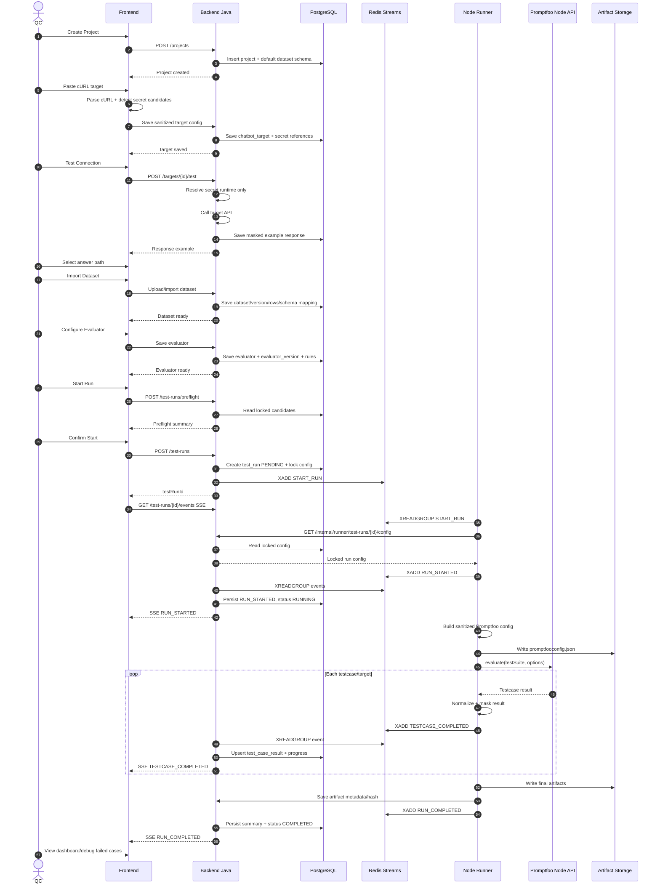

# VinFast QC Copilot — PRD v0.5

Version: `v0.5`  
Date: `2026-07-02`  
Status: MVP Product Requirement Draft  
DB Contract: PostgreSQL / ERD v0.3 aligned  
Execution Engine: Promptfoo Node API via adapter contract  
Queue: Redis Streams with safe trimming/recovery policy

---

## 1. Tổng quan sản phẩm

**VinFast QC Copilot** là platform hỗ trợ đội **QC/QA chuyên test chatbot hoặc AI nội bộ của công ty**.

Platform giúp QC/QA:

- Cấu hình chatbot nội bộ cần test bằng cURL.
- Import và quản lý dataset test.
- Tái sử dụng dataset từ project khác.
- Mapping dataset vào request chatbot.
- Cấu hình rule-based evaluator.
- Cấu hình LLM Judge.
- Chạy test tự động bằng Promptfoo Runner.
- Theo dõi tiến độ chạy realtime từng testcase.
- Xem kết quả từng testcase.
- Xem dashboard tổng quan.
- So sánh chatbot nội bộ với các LLM/model baseline khác.
- Debug lại request, response, extraction, evaluator reason và artifact của từng run.

**Promptfoo là execution engine chính**. VinFast QC Copilot không tự build toàn bộ evaluation engine từ đầu. Backend lưu domain config, runner chuyển domain config thành Promptfoo-compatible config và chạy bằng Promptfoo Node API.

Source of truth của hệ thống là **domain config trong backend database**, không phải Promptfoo config. Promptfoo config là generated artifact tại thời điểm chạy.

---

## 2. Điểm mới của PRD v0.5

So với PRD v0.4, bản v0.5 không đổi hướng kiến trúc chính, nhưng siết các điểm vận hành, security và upgrade-safety:

```text
1. Bổ sung research snapshot về Promptfoo version hiện tại: latest observed = 0.121.17 tại thời điểm 2026-07-02.
2. Chốt PromptfooAdapterContract để upgrade Promptfoo không làm domain/backend bị phụ thuộc trực tiếp vào internal API.
3. Chốt Promptfoo cache disabled by default cho internal chatbot target runs.
4. Chỉ cho phép bật cache trong controlled baseline/debug mode.
5. Bổ sung Redis Streams safe trimming rule để tránh trim mất pending messages.
6. Bổ sung Redis compatibility rule cho Redis < 8.2 và Redis >= 8.2.
7. Bổ sung handling khi XAUTOCLAIM gặp deleted/trimmed message ids.
8. Sửa dataset_schemas sang scope-aware model: PROJECT / WORKSPACE / PERSONAL.
9. Siết cURL/secret policy: không lưu raw_curl nguyên bản nếu có Authorization/API key.
10. raw_curl chỉ được lưu bản sanitized; secret thật tách sang Secret entity.
11. promptfoo_config_snapshot_json trong DB chỉ là sanitized compact snapshot.
12. Full artifact phải đi qua VfqcSensitiveDataMasker trước khi ghi file.
13. Lưu domain_config_hash, promptfoo_config_hash, config_sha256, result_sha256 để audit.
14. Bỏ custom_javascript khỏi MVP UI để tránh arbitrary code execution.
15. Bổ sung LLM Judge Output Normalization cho JSON verdict/reasoning/thinking output.
16. Bổ sung runner_events.sequence_no để SSE có thể replay theo Last-Event-ID.
17. Bổ sung Run Preflight để estimate row/target/judge calls/cost/duration trước khi chạy.
18. Đồng bộ Domain Entities/Database Tables với ERD v0.3.
```

---

## 2.1. External Research Snapshot v0.5

Research tại thời điểm tạo PRD v0.5:

```text
Research date: 2026-07-02
Promptfoo latest observed package version: 0.121.17
Promptfoo latest observed GitHub release: 0.121.17, release date 2026-06-16
Promptfoo install/runtime note: npm/npx require Node.js ^20.20.0 or >=22.22.0; Promptfoo docs recommend Node.js 24 for CI/custom Docker image.
Redis Streams recovery baseline: XAUTOCLAIM is available since Redis 6.2.0.
Redis Streams trimming note: XTRIM supports KEEPREF / DELREF / ACKED from Redis 8.2.
```

Source URLs checked:

```text
https://www.npmjs.com/package/promptfoo
https://github.com/promptfoo/promptfoo/releases
https://www.promptfoo.dev/docs/installation/
https://www.promptfoo.dev/docs/usage/node-api-reference/
https://www.promptfoo.dev/docs/configuration/caching/
https://redis.io/docs/latest/commands/xautoclaim/
https://redis.io/docs/latest/commands/xtrim/
```

Important rule:

```text
PRD không phụ thuộc trực tiếp vào latest Promptfoo version.
Runner phải pin exact version trong package-lock.json.
Upgrade Promptfoo chỉ được phép đi qua PromptfooAdapterContract regression suite.
```

---

## 3. Mục tiêu MVP

MVP cần đủ để QC hoàn thành flow:

```text
1. Vào workspace.
2. Tạo project test chatbot.
3. Cấu hình secret/provider/model.
4. Paste cURL chatbot nội bộ.
5. Frontend parse cURL thành method, URL, headers, query params, body.
6. Mapping dataset fields vào request.
7. Import dataset từ Excel hoặc project khác.
8. Cấu hình evaluator.
9. Chạy test bằng Promptfoo Runner.
10. Theo dõi tiến độ realtime từng testcase.
11. Xem kết quả từng testcase.
12. Chạy comparison với baseline model.
13. Xem dashboard so sánh.
14. Debug testcase fail bằng request/response/evaluator reason/artifact.
15. Cancel run khi cần.
```

---

## 4. Primary User

MVP chỉ tập trung vào nhóm user chính:

```text
QC / QA team chuyên test chatbot hoặc AI nội bộ của công ty
```

MVP chưa ưu tiên:

```text
- External customer
- Public SaaS user
- Business user không thuộc đội QC
- Developer platform user bên ngoài
```

---

# 5. Core Architecture

## 5.1. Kiến trúc tổng quan

```text
Frontend
  ├── cURL Parser UI
  ├── Dataset Import UI
  ├── Dataset Mapping UI
  ├── Evaluator Builder UI
  ├── Test Run Dashboard
  └── SSE Client for realtime progress

Backend Java
  ├── Auth / Permission
  ├── Workspace / Project Management
  ├── Secret / Provider Management
  ├── Dataset / Schema / Version Management
  ├── Chatbot Target Config Storage
  ├── Evaluator Config / Version Storage
  ├── Test Run Orchestration
  ├── Redis Stream Producer
  ├── Redis Stream Consumer
  ├── Redis Pending Recovery Worker
  ├── SSE Event Publisher
  ├── Result Persistence
  └── Artifact Metadata Storage

Redis Streams
  ├── vfqc:runs:commands
  ├── vfqc:runs:events
  ├── vfqc:runs:commands:dlq
  └── vfqc:runs:events:dlq

Runner Node.js
  ├── Redis Stream Consumer
  ├── Redis Pending Recovery Support
  ├── Promptfoo Config Builder
  ├── Promptfoo Node API Executor
  ├── Result Normalizer
  ├── Sensitive Data Masker
  ├── Local Artifact Writer
  └── Redis Stream Event Publisher

Local Artifact Storage
  └── ./storage/artifacts/test-runs/{testRunId}/
```

---

## 5.2. Source of Truth

Source of truth của hệ thống là **domain config trong backend database**:

```text
Backend Domain Config
  ├── Workspace
  ├── Project
  ├── Dataset / DatasetVersion
  ├── DatasetSchema / DatasetSchemaColumn
  ├── Chatbot Target
  ├── Evaluator / EvaluatorVersion
  ├── Provider / Secret Reference
  └── Test Run
```

Mỗi test run phải lưu snapshot/audit metadata:

```text
- domain_config_snapshot_json              # sanitized compact snapshot
- domain_config_hash                       # SHA-256 của canonical domain snapshot
- promptfoo_config_snapshot_json           # sanitized compact generated config snapshot
- promptfoo_config_hash                    # SHA-256 của canonical promptfoo config snapshot
- promptfoo_version
- promptfoo_adapter_schema_version
- dataset_id
- dataset_version_id
- dataset_schema_id
- dataset_schema_version
- evaluator versions
- judge_provider_id
- judge_model
- test_run_targets
- artifact paths
- config_sha256 / result_sha256 ở artifact metadata
- normalized result trong database
```

Quyết định security:

```text
1. DB không lưu plain text secret.
2. DB không lưu raw_curl nguyên bản nếu cURL có Authorization/API key/token/cookie.
3. promptfoo_config_snapshot_json trong DB chỉ là sanitized compact snapshot.
4. Full Promptfoo config/result/report/log artifact phải qua VfqcSensitiveDataMasker trước khi ghi file.
5. Full generated config file để artifact storage, DB chỉ giữ compact snapshot + hash.
```

Lý do:

```text
1. Debug được run cũ.
2. Result cũ không bị đổi nghĩa khi config mới thay đổi.
3. Audit chính xác runner đã chạy gì mà không lộ secret.
4. Có thể đổi execution engine hoặc upgrade Promptfoo mà không phá domain model.
5. Có thể verify artifact integrity bằng hash.
```

---

# 6. Workspace Design

## 6.1. Workspace Type

MVP hỗ trợ:

```text
PERSONAL
TEAM
```

### Personal Workspace

Được tạo tự động khi user đăng ký.

```text
User mới → Personal Workspace → user là OWNER
```

### Team Workspace

Dùng cho team QC làm việc chung.

Team Workspace chứa:

```text
- Members
- Projects
- Workspace Secrets
- Workspace Providers
- Workspace Datasets
- Shared test configs
```

---

## 6.2. Role Model

Hệ thống có 2 tầng role:

```text
1. System role:
   users.system_role = PLATFORM_ADMIN | USER

2. Workspace role:
   workspace_members.role = OWNER | ADMIN | MEMBER | VIEWER
```

Rule tổng quát:

```text
1. Nếu action là xem lại plain text secret:
   DENY cho mọi role, kể cả PLATFORM_ADMIN.

2. Nếu users.system_role = PLATFORM_ADMIN:
   ALLOW gần như mọi action còn lại.

3. Nếu users.system_role = USER:
   Check workspace_members.role.

4. Nếu user không phải member workspace:
   DENY.
```

---

## 6.3. Permission Matrix MVP

| Action                  | Owner | Admin | Member | Viewer |
| ----------------------- | ----: | ----: | -----: | -----: |
| Xem workspace           | Có    | Có    | Có     | Có     |
| Sửa workspace           | Có    | Có    | Không  | Không  |
| Xóa/archive workspace   | Có    | Không | Không  | Không  |
| Mời member              | Có    | Có    | Không  | Không  |
| Đổi role member         | Có    | Có    | Không  | Không  |
| Tạo project             | Có    | Có    | Có     | Không  |
| Sửa project             | Có    | Có    | Có     | Không  |
| Xem project             | Có    | Có    | Có     | Có     |
| Import dataset          | Có    | Có    | Có     | Không  |
| Reuse dataset           | Có    | Có    | Có     | Không  |
| Cấu hình chatbot target | Có    | Có    | Có     | Không  |
| Cấu hình evaluator      | Có    | Có    | Có     | Không  |
| Chạy test               | Có    | Có    | Có     | Không  |
| Cancel test run         | Có    | Có    | Có     | Không  |
| Xem dashboard           | Có    | Có    | Có     | Có     |
| Tạo Workspace Secret    | Có    | Có    | Không  | Không  |
| Tạo Workspace Provider  | Có    | Có    | Không  | Không  |
| Tạo Personal Secret     | Có    | Có    | Có     | Không  |
| Tạo Personal Provider   | Có    | Có    | Có     | Không  |
| Xem plain text secret   | Không | Không | Không  | Không  |

---

# 7. Secret & Provider Design

## 7.1. Secret Scope

MVP hỗ trợ:

```text
PERSONAL
WORKSPACE
```

### Personal Secret

Do user tạo.

Dùng khi:

```text
- QC có API key riêng.
- Workspace key hết quota.
- Workspace key invalid.
- QC muốn fallback sang provider cá nhân.
```

### Workspace Secret

Do Owner/Admin tạo.

Dùng khi:

```text
- Admin setup sẵn key cho team QC.
- Team dùng chung provider/model.
- QC không cần tự nhập API key.
```

Không role nào được xem lại plain text secret sau khi secret đã lưu.

---

## 7.2. Provider Scope

MVP hỗ trợ:

```text
PERSONAL_PROVIDER
WORKSPACE_PROVIDER
```

Provider có thể dùng cho:

```text
- LLM Judge
- Baseline model trong comparison run
- Dataset generation ở phase sau
```

Provider type MVP:

```text
OPENAI_COMPATIBLE
GEMINI
CLAUDE
CUSTOM_HTTP
```

Provider entity cần lưu:

```text
id
scope
owner_user_id
workspace_id
name
provider_type
secret_id
base_url
default_model
available_models_json
config_json
status
created_by
created_at
updated_at
deleted_at
```

---

# 8. Project Design

Project là nơi QC cấu hình test cho một chatbot hoặc một nhóm chatbot liên quan.

Một project thuộc một workspace.

Project chứa:

```text
- Dataset Schema
- Datasets
- Chatbot Targets
- Evaluators
- Test Runs
- Comparison Runs
- Reports / Dashboard
```

Project entity:

```text
id
workspace_id
name
description
created_by
created_at
updated_at
archived_at
deleted_at
```

MVP chưa có project-level permission riêng.

---

# 9. Dataset Schema Design

## 9.1. Schema Scope v0.5

v0.5 sửa dataset schema sang **scope-aware model** để khớp với dataset scope.

MVP hỗ trợ schema scope:

```text
PROJECT
WORKSPACE
PERSONAL
```

Scope rule:

```text
PROJECT:
  project_id NOT NULL
  workspace_id NULL
  owner_user_id NULL

WORKSPACE:
  workspace_id NOT NULL
  project_id NULL
  owner_user_id NULL

PERSONAL:
  owner_user_id NOT NULL
  workspace_id NULL
  project_id NULL
```

Lý do đổi so với v0.4:

```text
1. v0.4 để dataset_schemas.project_id bắt buộc, trong khi datasets có scope PROJECT / WORKSPACE / PERSONAL.
2. Nếu workspace/personal dataset vẫn dùng schema thuộc project thì domain bị lệch.
3. Schema scope-aware giúp dataset dùng chung trong workspace/personal có schema độc lập.
4. Khi import dataset vào project, hệ thống có thể clone/mapping schema rõ ràng.
```

---

## 9.2. Default Schema

Khi tạo project, hệ thống tạo schema mặc định scope PROJECT:

```text
question
expected
```

Khi tạo workspace/personal dataset độc lập, hệ thống cũng tạo schema tương ứng với scope của dataset.

User có thể:

```text
- Đổi tên cột
- Thêm cột
- Sửa cột
- Xóa cột
- Đổi mô tả
- Set required / optional
```

Ví dụ schema mở rộng:

```text
question
expected
context
category
difficulty
expected_intent
expected_sources
```

---

## 9.3. Schema Versioning

Schema cần có version.

Lý do:

```text
1. Import Excel có thể thêm cột mới.
2. Import dataset từ project/workspace/personal dataset khác có thể khác schema.
3. Evaluator mapping phụ thuộc vào tên cột.
4. Test run cũ cần biết chính xác schema lúc chạy.
```

Test run phải lock:

```text
dataset_schema_id
dataset_schema_version
```

---

## 9.4. Schema Compatibility Rule

Khi reuse/import dataset:

```text
1. Nếu source schema giống target schema → clone rows trực tiếp.
2. Nếu source schema khác target schema → bắt buộc mapping step.
3. Nếu user thêm cột mới khi import → tạo schema version mới ở target scope.
4. TestRun luôn dùng schema đã lock, không phụ thuộc current schema sau này.
```

---

# 10. Dataset Design

## 10.1. Dataset Scope

MVP hỗ trợ:

```text
PROJECT
WORKSPACE
PERSONAL
```

### Project Dataset

Dataset thuộc project hiện tại.

### Workspace Dataset

Dataset dùng chung trong workspace.

### Personal Dataset

Dataset thuộc user, có thể reuse ở workspace khác nếu user có quyền trong project đích.

---

## 10.2. Dataset Versioning

Dataset có nhiều version:

```text
Dataset
  ├── DatasetVersion v1
  ├── DatasetVersion v2
  └── DatasetVersion v3
```

Rule:

```text
1. DatasetVersion ACTIVE là immutable.
2. Sửa dataset tạo DatasetVersion mới.
3. TestRun lock dataset_version_id.
4. Dataset rows thuộc DatasetVersion, không thuộc trực tiếp Dataset.
5. current_version_id trên datasets trỏ tới version đang active/current.
```

Lý do:

```text
- Đảm bảo run cũ không đổi kết quả khi dataset được sửa.
- Comparison run công bằng vì mọi target dùng chung dataset_version_id.
- Có thể trace dataset clone/import từ version nguồn.
```

---

## 10.3. Mapping Dataset sang Promptfoo

Mỗi dataset row sẽ trở thành một Promptfoo test case.

Ví dụ dataset row:

```json
{
  "question": "VF 8 có mấy phiên bản?",
  "expected": "VF 8 có các phiên bản Eco và Plus.",
  "context": "Thông tin sản phẩm VF 8",
  "category": "product_info",
  "difficulty": "easy"
}
```

Runner convert thành Promptfoo test case:

```yaml
tests:
  - vars:
      question: "VF 8 có mấy phiên bản?"
      expected: "VF 8 có các phiên bản Eco và Plus."
      context: "Thông tin sản phẩm VF 8"
    metadata:
      category: "product_info"
      difficulty: "easy"
```

---

## 10.4. UI Variable Syntax

Trong UI, QC nhìn thấy biến theo dạng dễ hiểu:

```text
$dataset.question
$dataset.expected
$dataset.context
```

Runner convert sang Promptfoo template syntax:

```text
{{question}}
{{expected}}
{{context}}
```

Quyết định này giúp:

```text
1. UI thân thiện với QC.
2. Backend domain không bị phụ thuộc trực tiếp vào Promptfoo syntax.
3. Runner chịu trách nhiệm mapping sang Promptfoo.
```

---

# 11. Import Dataset

## 11.1. Import từ Excel

Flow:

```text
1. QC upload Excel.
2. Hệ thống đọc sheets/cột.
3. QC chọn sheet.
4. UI preview 10-20 dòng đầu.
5. QC mapping Excel columns với project schema.
6. Với từng cột Excel, QC chọn:
   - Map vào cột schema hiện có
   - Ignore
   - Add as new schema column
7. Nếu add new column, hệ thống tạo schema version mới.
8. QC xác nhận import.
9. Backend lưu dataset + dataset version + dataset rows.
```

---

## 11.2. Import Dataset từ Project khác

Entry point:

```text
Project Detail → Datasets tab → Import Dataset
```

Modal import có options:

```text
- From Excel
- From another project
- From workspace dataset
- From my datasets
```

MVP ưu tiên flow **From another project**.

---

## 11.3. Flow: From another project

```text
1. QC bấm Import Dataset.
2. Chọn From another project.
3. Modal hiển thị search bar + list project user có quyền xem.
4. QC search/chọn project nguồn.
5. Modal hiển thị list dataset trong project nguồn.
6. QC chọn dataset và dataset version nguồn.
7. UI hiển thị preview dataset.
8. Hệ thống check schema compatibility.
9. Nếu schema giống, cho clone luôn.
10. Nếu schema khác, mở mapping step.
11. QC mapping cột source dataset sang schema project hiện tại.
12. QC xác nhận clone.
13. Backend clone toàn bộ dataset rows vào dataset version mới trong project hiện tại.
14. Dataset mới lưu source metadata để trace.
```

MVP clone toàn bộ rows.

Chưa hỗ trợ:

```text
- Clone selected rows
- Live reference dataset
- Auto sync dataset từ source
```

Dataset clone cần lưu:

```text
source_dataset_id
source_dataset_version_id
source_project_id
source_workspace_id
source_type
import_mapping_json
created_by
created_at
```

---

# 12. Chatbot Target Design

## 12.1. MVP chỉ hỗ trợ cURL

Flow:

```text
1. QC paste raw cURL ở frontend.
2. Frontend parse thành:
   - method
   - url
   - headers
   - query params
   - body
3. Frontend hiển thị preview.
4. QC chỉnh sửa nếu cần.
5. QC mapping dataset fields vào request.
6. Frontend gửi backend:
   - sanitizedRawCurl
   - parsedRequestConfig
   - datasetMapping
   - extractedSecretCandidates
7. Backend validate và tách secret thật sang Secret entity nếu có.
8. Backend lưu sanitized request config.
9. Backend/Runner test connection.
10. Hệ thống lưu example request và example response đã mask.
```

Backend không parse lại raw cURL bằng shell.

Backend không shell-execute raw cURL.

Backend lưu sanitized cURL để trace/audit, còn khi chạy thật dùng parsed request config + secret reference.

---

## 12.2. cURL & Secret Security Policy v0.5

Quyết định bắt buộc:

```text
1. Không lưu raw_curl nguyên bản nếu có Authorization/API key/token/cookie/credential.
2. raw_curl lưu trong DB chỉ là bản sanitized.
3. Secret thật được tách thành Secret entity.
4. Header/body/query chứa secret phải được thay bằng secret reference hoặc env placeholder.
5. promptfoo_config_snapshot_json trong DB là sanitized compact snapshot.
6. Full artifact cũng phải đi qua VfqcSensitiveDataMasker trước khi ghi file.
7. Lưu config_hash/result_hash để audit.
```

Ví dụ sanitized cURL:

```bash
curl -X POST "https://internal-chatbot.example.com/api/chat" \
  -H "Content-Type: application/json" \
  -H "Authorization: Bearer ****MASKED****" \
  -d '{"question":"$dataset.question"}'
```

Khi runner build request thật:

```text
1. Runner lấy run config đã lock từ Backend API.
2. Runner lấy secret thông qua secure secret resolution flow.
3. Runner inject secret vào request runtime only.
4. Runner không ghi secret vào DB/log/artifact/event.
```

---

## 12.3. Chatbot Target Entity

```text
id
project_id
name
description
raw_curl_sanitized
raw_curl_hash
method
url
headers_json              # sanitized
query_params_json         # sanitized
body_json                 # sanitized
auth_config_json          # secret references only
dataset_mapping_json
latest_example_id
response_extraction_config_json
status
created_by
created_at
updated_at
deleted_at
```

---

## 12.4. Chatbot Target Example History

Mỗi lần test connection tạo một row mới trong `chatbot_target_examples`.

Lý do:

```text
1. Lưu lịch sử request/response khi QC test connection.
2. Debug được việc target từng hợp lệ/invalid theo thời gian.
3. latest_example_id trên chatbot_targets chỉ trỏ tới example mới nhất.
4. Sensitive fields phải được mask trước khi lưu.
```

Example entity:

```text
id
chatbot_target_id
request_json              # sanitized
response_status_code
response_headers_json     # sanitized
response_body_json        # sanitized
extracted_output_json
latency_ms
error_message
tested_by
created_at
```

---

## 12.5. Response Extraction

Khi test connection, hệ thống lưu example response đã mask.

Ví dụ:

```json
{
  "status": "success",
  "data": {
    "answer": "VF 8 có hai phiên bản Eco và Plus.",
    "intent": "product_info",
    "confidence": 0.92
  },
  "metadata": {
    "latency": 1200
  }
}
```

QC chọn field chính:

```text
Main answer path: $.data.answer
Intent path: $.data.intent
Confidence path: $.data.confidence
```

Runner convert main answer path thành Promptfoo `transformResponse`.

---

# 13. Evaluator Design

## 13.1. Evaluator Types

MVP hỗ trợ:

```text
RULE_BASED
LLM_JUDGE
MIXED
```

---

## 13.2. Rule-based Evaluator

Rule gồm:

```text
field_source
operator
expected_value
weight
required
order_index
config_json
```

Ví dụ:

```text
response.status equals "success"
response.data.intent equals $dataset.expected_intent
response.data.answer contains $dataset.expected
response.data.confidence greater_than_or_equal 0.7
latency_ms less_than 3000
```

Operator MVP:

```text
equals
not_equals
contains
not_contains
regex
exists
not_exists
is_empty
is_not_empty
greater_than
greater_than_or_equal
less_than
less_than_or_equal
is_json
contains_json
```

Không expose `custom_javascript` trong MVP UI.

Mapping sang Promptfoo:

| UI Operator              | Promptfoo Mapping / Adapter Strategy |
| ------------------------ | ------------------------------------ |
| equals                   | `equals`                             |
| contains                 | `contains`                           |
| regex                    | `regex`                              |
| is_json                  | `is-json`                            |
| contains_json            | `contains-json`                      |
| greater_than / less_than | Adapter-generated safe JS assertion  |
| complex JSON path        | Adapter-generated safe JS assertion  |

Ghi chú:

```text
Adapter-generated JS assertion là code do hệ thống generate từ operator an toàn.
User/QC không nhập arbitrary JavaScript trong MVP.
```

---

## 13.3. LLM Judge Evaluator

LLM Judge config gồm:

```text
name
judge_provider_id
judge_model
rubric
threshold
score_scale
pass_condition
input_template
output_schema
```

Ví dụ rubric:

```text
Chấm câu trả lời theo thang điểm 0-10.
Pass nếu score >= 7.

Tiêu chí:
1. Đúng ý chính so với expected.
2. Không hallucinate.
3. Không bỏ sót thông tin quan trọng.
4. Trả lời rõ ràng, phù hợp ngữ cảnh.
```

Runner map sang Promptfoo model-graded assertion, ví dụ `llm-rubric`.

---

## 13.4. LLM Judge Output Normalization

LLM Judge Output Normalization là bắt buộc trong MVP.

Rule:

```text
1. Judge prompt yêu cầu output JSON schema cố định.
2. Runner parse tolerant JSON.
3. Nếu provider có reasoning/thinking field riêng, bỏ reasoning khỏi verdict parser.
4. Nếu parse fail, testcase status = ERROR hoặc JUDGE_ERROR, không coi là business fail.
5. Lưu raw judge response đã mask vào artifact để debug.
```

Canonical judge output schema:

```json
{
  "score": 0.86,
  "passed": true,
  "reason": "Answer matches the expected product information and does not hallucinate.",
  "errors": [],
  "criteria": [
    {
      "name": "correctness",
      "score": 0.9,
      "reason": "Main facts are correct."
    }
  ]
}
```

Parse rule:

```text
1. Nếu output là valid JSON → parse trực tiếp.
2. Nếu output có text trước/sau JSON → extract JSON object đầu tiên hợp lệ.
3. Nếu provider trả reasoning/thinking riêng → ignore field đó khi parse verdict.
4. Nếu không parse được → component result = JUDGE_ERROR.
5. JUDGE_ERROR làm testcase status = ERROR, không phải FAILED business-level.
```

---

## 13.5. Custom JavaScript Decision

MVP chọn:

```text
Option A: bỏ custom_javascript khỏi MVP UI.
```

Lý do:

```text
1. User-provided JavaScript là arbitrary code execution.
2. Runner có thể truy cập network/filesystem/secret runtime nếu sandbox không chặt.
3. MVP ưu tiên operator an toàn và adapter-generated JS nội bộ.
4. Nếu cần custom JS ở phase sau, phải có sandbox/container isolation, timeout, allowlist API và role restriction.
```

Out of scope MVP:

```text
- QC nhập JavaScript trực tiếp.
- Upload JS assertion file.
- External JS provider do user nhập.
```

---

## 13.6. Evaluator Versioning

Evaluator cần versioning.

```text
Evaluator
  ├── EvaluatorVersion v1
  └── EvaluatorVersion v2
```

Rule:

```text
1. Đổi rule/rubric tạo EvaluatorVersion mới.
2. EvaluatorVersion đã được TestRun dùng thì không update.
3. Rule-based rules thuộc evaluator_versions qua bảng evaluator_rules.
4. TestRun lock evaluator versions qua test_run_evaluator_versions.
```

Lý do:

```text
1. Rubric đổi sẽ làm result đổi.
2. Rule đổi sẽ làm pass/fail đổi.
3. Comparison chỉ công bằng nếu dùng cùng evaluator version.
```

---

# 14. Comparison Design

## 14.1. Mục tiêu

Comparison giúp QC so sánh chatbot nội bộ với một hoặc nhiều baseline models.

MVP hỗ trợ:

```text
1 internal chatbot target
+ 1 hoặc nhiều LLM baseline targets
```

---

## 14.2. Điều kiện comparison công bằng

Các target trong cùng comparison run phải dùng chung:

```text
- Dataset
- Dataset version
- Schema version
- Evaluator versions
- Judge provider
- Judge model
- Run config snapshot
```

Chỉ khác:

```text
- Target chatbot/model/provider
```

---

## 14.3. Comparison Dashboard MVP

Dashboard hiển thị:

```text
- Pass rate theo target
- Average score theo target
- Average latency theo target
- Failed count theo target
- Error count theo target
- Cost/token nếu có
- Bảng từng testcase theo target
- Judge reason từng target
```

MVP chưa cần auto winner bằng LLM.

Có thể hiển thị đơn giản:

```text
- Highest score
- Lowest latency
- Passed targets
```

---

# 15. Execution Architecture v0.5

## 15.1. Queue MVP

MVP dùng **Redis Streams** để giao tiếp giữa Backend và Runner.

Redis Streams phù hợp vì:

```text
1. Có append-only stream cho command/event.
2. Có consumer groups để nhiều runner chia việc.
3. Có pending entries để recover khi consumer crash.
4. Có ACK để kiểm soát xử lý at-least-once.
5. Có thể trim stream để kiểm soát dung lượng.
```

MVP dùng 4 streams:

```text
vfqc:runs:commands
vfqc:runs:events
vfqc:runs:commands:dlq
vfqc:runs:events:dlq
```

Consumer groups:

```text
vfqc:runs:commands
  group: vfqc-runners
  consumers: runner instance ids

vfqc:runs:events
  group: vfqc-backend-events
  consumers: backend instance ids
```

---

## 15.2. `vfqc:runs:commands`

Backend publish command.

Runner consume command.

Command chỉ chứa reference, không chứa full dataset/config/secret.

Ví dụ START_RUN:

```json
{
  "commandId": "cmd_123",
  "commandType": "START_RUN",
  "testRunId": "run_123",
  "projectId": "project_456",
  "requestedBy": "user_789",
  "createdAt": "2026-07-01T10:00:00+07:00"
}
```

Ví dụ CANCEL_RUN:

```json
{
  "commandId": "cmd_124",
  "commandType": "CANCEL_RUN",
  "testRunId": "run_123",
  "requestedBy": "user_789",
  "createdAt": "2026-07-01T10:02:00+07:00"
}
```

---

## 15.3. `vfqc:runs:events`

Runner publish event.

Backend consume event.

Redis event chứa **normalized result compact**, không chứa artifact lớn.

Ví dụ TESTCASE_COMPLETED:

```json
{
  "eventId": "evt_001",
  "eventType": "TESTCASE_COMPLETED",
  "testRunId": "run_123",
  "runnerId": "runner_01",
  "datasetRowId": "row_001",
  "targetId": "target_internal_bot",
  "passed": true,
  "score": 0.86,
  "latencyMs": 1200,
  "completed": 1,
  "total": 100,
  "createdAt": "2026-07-01T10:00:15+07:00"
}
```

Full artifact lưu local hoặc object storage abstraction.

Không nhét full report hoặc file lớn vào Redis Stream.

---

## 15.4. Communication Flow

```text
1. User click Run.
2. Backend validate permission.
3. Backend validate max dataset rows per run.
4. Backend lock dataset/schema/evaluator versions.
5. Backend tạo test_run status = PENDING.
6. Backend tạo runner_commands row với command_id unique.
7. Backend XADD START_RUN vào vfqc:runs:commands.
8. Runner consume START_RUN bằng XREADGROUP.
9. Runner check idempotency và test_run.status.
10. Runner lấy full run config từ Backend API.
11. Runner publish RUN_STARTED.
12. Runner build Promptfoo config.
13. Runner write promptfoo config artifact.
14. Runner chạy Promptfoo bằng Node API.
15. Runner publish TESTCASE_STARTED/TESTCASE_COMPLETED/RUN_PROGRESS events.
16. Backend consume events bằng XREADGROUP.
17. Backend persist result vào DB.
18. Backend ACK event sau khi persist thành công.
19. Backend đẩy realtime progress xuống frontend qua SSE.
20. Khi run xong, runner publish RUN_COMPLETED/RUN_FAILED/RUN_CANCELLED.
21. Backend persist final state.
22. Runner ACK command sau khi final event publish thành công.
```

---

## 15.5. Backend ↔ Runner Data Contract

Runner gọi Backend API để lấy full config:

```text
GET /internal/runner/test-runs/{testRunId}/config
```

Lý do command chỉ chứa reference:

```text
1. Redis message nhỏ.
2. Không expose secret/dataset lớn trong queue.
3. Backend vẫn là source of truth.
4. Runner luôn lấy config đã lock theo test run.
5. Dễ retry/recover vì config lấy lại được từ DB.
```

Control API cho cancellation:

```text
GET /internal/runner/test-runs/{testRunId}/control-state
```

Response:

```json
{
  "testRunId": "run_123",
  "status": "CANCELLING",
  "shouldCancel": true
}
```

---

## 15.6. ACK Rule

### Runner ACK command

Runner chỉ ACK START_RUN khi:

```text
1. Run đã COMPLETED/FAILED/CANCELLED; và
2. Runner đã publish final event thành công; và
3. Artifact final đã được write xong hoặc lỗi artifact đã được ghi nhận thành RUN_FAILED.
```

Runner ACK CANCEL_RUN khi:

```text
1. Runner đã ghi nhận cancel; hoặc
2. Run đã ở terminal state nên command được SKIPPED idempotently.
```

### Backend ACK event

Backend chỉ ACK event khi:

```text
1. Event đã được persist vào DB; và
2. Side effect tương ứng đã hoàn tất:
   - update test_runs progress/status
   - insert/update test_case_results
   - update runner_events.processed_at
3. Nếu persist fail thì không ACK để message nằm pending và recover sau.
```

---

## 15.7. Pending Recovery

v0.5 chốt **có pending recovery trong MVP**.

Cơ chế:

```text
1. Runner recovery worker inspect pending command bằng XPENDING.
2. Nếu message idle quá threshold, runner dùng XAUTOCLAIM để claim về consumer khỏe.
3. Backend event recovery worker inspect pending event bằng XPENDING.
4. Nếu event idle quá threshold, backend dùng XAUTOCLAIM để claim lại.
5. Mỗi message tăng attempt_count trong DB hoặc payload metadata.
6. Nếu attempt_count > maxAttempts thì chuyển sang DLQ.
```

Default:

```text
pendingIdleThresholdMs = 60_000
recoveryIntervalMs = 30_000
maxAttempts = 3
```

Rule:

```text
- Pending command chưa ACK có thể được runner khác claim lại.
- Pending event chưa ACK có thể được backend instance khác claim lại.
- Handler phải idempotent vì Redis Streams delivery là at-least-once.
```

---

## 15.8. Dead-letter Streams

MVP dùng 2 dead-letter streams:

```text
vfqc:runs:commands:dlq
vfqc:runs:events:dlq
```

Khi message vượt quá `maxAttempts`, consumer publish DLQ event:

```json
{
  "originalStream": "vfqc:runs:commands",
  "originalMessageId": "1690000000000-0",
  "messageType": "START_RUN",
  "testRunId": "run_123",
  "attemptCount": 4,
  "lastError": "Backend config API timeout",
  "movedAt": "2026-07-01T10:05:00+07:00"
}
```

DLQ rule:

```text
1. DLQ không tự retry trong MVP.
2. Platform Admin có thể xem DLQ qua internal admin/debug page ở phase sau.
3. MVP cần log DLQ rõ ràng để backend/runner operator xử lý thủ công.
4. Nếu START_RUN vào DLQ, test_run chuyển FAILED với error_message system-level.
5. Nếu event final vào DLQ, backend recovery phải reconcile test_run bằng snapshot/results artifact nếu có.
```

---

## 15.9. Stream Retention / Trimming

Redis stream không được tăng vô hạn, nhưng trimming không được làm mất pending message chưa ACK.

MVP policy:

```text
vfqc:runs:commands:
  retention: keep last 100_000 messages hoặc 7 ngày, tùy config triển khai

vfqc:runs:events:
  retention: keep last 1_000_000 messages hoặc 7 ngày, tùy config triển khai

DLQ streams:
  retention: keep last 100_000 messages hoặc 30 ngày
```

Implementation option:

```text
- XADD ... MAXLEN ~ <limit> cho approximate trimming theo số lượng.
- Hoặc scheduled XTRIM MINID theo thời gian nếu cần retention theo ngày.
```

Safe trimming rule:

```text
1. Không trim command/event stream thấp hơn oldest pending message id.
2. Nếu dùng Redis >= 8.2, ưu tiên XTRIM ... ACKED cho stream có consumer group.
3. Nếu dùng Redis < 8.2, scheduled trimming phải check XPENDING trước.
4. Nếu XAUTOCLAIM trả về deleted/trimmed message ids, recovery worker không retry như message bình thường.
5. Deleted/trimmed pending message phải ghi reconcile log và chuyển test_run/event sang trạng thái recoverable hoặc DLQ tùy context.
```

Redis compatibility:

```text
Redis >= 6.2:
  - XAUTOCLAIM available.
  - Có thể dùng XPENDING + XAUTOCLAIM cho pending recovery.

Redis >= 8.2:
  - XTRIM hỗ trợ KEEPREF / DELREF / ACKED.
  - Nên dùng ACKED để tránh trim message chưa được mọi consumer group ACK.
```

DB vẫn là source of truth lâu dài.

Redis Streams chỉ là transport/recovery buffer ngắn hạn.

---

# 16. Runner Design

## 16.1. Runner Tech Stack

Runner là Node.js service.

MVP dùng:

```text
Promptfoo Node API only
```

Không dùng CLI fallback.

Lý do:

```text
1. Không cần spawn process.
2. Build Promptfoo config trực tiếp bằng object.
3. Dễ control execution context.
4. Dễ normalize result bằng code.
5. Phù hợp service chạy lâu dài.
6. Dễ pin version bằng package-lock.
```

---

## 16.2. Promptfoo Version Pin & Upgrade Rule

v0.5 chốt:

```text
1. Runner phải pin promptfoo exact version trong package.json/package-lock.json.
2. Không dùng promptfoo@latest trong runtime production.
3. Latest observed tại thời điểm PRD v0.5: 0.121.17.
4. package-lock.json là source of truth version thực tế khi deploy.
5. Khi tạo TestRun, backend/runner lưu promptfoo_version vào snapshot/artifact metadata.
6. Khi upgrade Promptfoo, bắt buộc chạy PromptfooAdapterContract regression suite.
```

Lưu vào:

```text
test_runs.domain_config_snapshot_json.promptfooVersion
test_runs.domain_config_snapshot_json.promptfooAdapterSchemaVersion
promptfoo_run_artifacts metadata
artifact ./storage/artifacts/test-runs/{testRunId}/metadata.json
```

Upgrade rule:

```text
1. Không upgrade trực tiếp trong production.
2. Upgrade trong branch riêng.
3. Chạy adapter regression suite với fixture cố định.
4. So sánh normalized result schema, không so sánh raw Promptfoo internal result một cách mù quáng.
5. Nếu Promptfoo output thay đổi, chỉ sửa PromptfooAdapter, không sửa domain model nếu không bắt buộc.
```

---

## 16.3. Runner Instance Model

Mỗi runner instance xử lý **1 test run tại một thời điểm**.

Scale bằng nhiều runner instances.

```text
runner-01 → run A
runner-02 → run B
runner-03 → run C
```

Lý do:

```text
1. MVP đơn giản.
2. Dễ giới hạn memory.
3. Dễ debug.
4. Dễ cancel.
5. Dễ scale ngang.
6. Tránh một process ôm quá nhiều run nặng.
```

---

## 16.4. Runner Heartbeat

v0.5 chốt **có heartbeat monitor trong MVP**.

Runner update heartbeat:

```text
runner_instances.last_heartbeat_at
runner_instances.status
runner_instances.current_test_run_id
```

Default:

```text
heartbeatIntervalSeconds = 10
runnerOfflineThresholdSeconds = 45
```

Backend monitor:

```text
1. Nếu runner không heartbeat quá threshold → status OFFLINE.
2. Nếu runner OFFLINE khi đang giữ current_test_run_id:
   - backend không tự mark run FAILED ngay lập tức.
   - command/event recovery sẽ reclaim pending message.
   - nếu quá maxAttempts hoặc timeout toàn run thì mark FAILED.
```

---

## 16.5. Runner Lifecycle

```text
1. Boot runner.
2. Register runnerId.
3. Start heartbeat loop.
4. Join Redis consumer group vfqc-runners.
5. Wait START_RUN command bằng XREADGROUP.
6. Claim one command.
7. Check idempotency.
8. Fetch full run config.
9. Publish RUN_STARTED.
10. Build Promptfoo config.
11. Write promptfooconfig.json artifact.
12. Execute Promptfoo Node API.
13. For each testcase:
    - check cancellation flag
    - run target/baseline
    - run evaluator/judge
    - mask sensitive fields
    - write partial artifact nếu cần
    - publish TESTCASE_COMPLETED
14. On completed:
    - write final result artifacts
    - publish RUN_COMPLETED
    - ACK command
15. On cancelled:
    - write partial/final cancel artifact
    - publish RUN_CANCELLED
    - ACK command
16. On failed:
    - write error artifact/log
    - publish RUN_FAILED
    - ACK command nếu lỗi đã được xử lý và final event publish thành công
```

---

# 17. Promptfoo Integration

## 17.1. Promptfoo Config Builder

Runner có component:

```text
PromptfooConfigBuilder
```

Input:

```text
- Test run config
- Dataset rows
- Chatbot targets
- Baseline providers
- Evaluator versions
- Judge provider/model
- Response extraction config
```

Output:

```text
Promptfoo TestSuiteConfiguration object
```

Runner build object trực tiếp, không cần sinh YAML để chạy.

---

## 17.2. PromptfooAdapterContract

v0.5 bổ sung adapter contract để hệ thống không bị lock cứng vào Promptfoo internal result/config format.

```text
Component: PromptfooAdapter
Input: LockedRunConfig
Output 1: PromptfooTestSuiteConfiguration
Output 2: NormalizedRunResult / NormalizedTestCaseResult
Adapter schema version: promptfoo_adapter_schema_version
```

Contract phải cover tối thiểu các fixture:

```text
1. HTTP target + transformResponse.
2. Rule-based only.
3. LLM judge only.
4. Mixed evaluator.
5. Comparison run nhiều targets.
6. Target timeout/error.
7. Judge parse error / reasoning output.
8. Sanitized artifact generation.
```

Upgrade Promptfoo chỉ được merge nếu các fixture trên pass.

---

## 17.3. Promptfoo Cache Policy

MVP chốt:

```text
Promptfoo cache is disabled by default for internal chatbot target runs.

Cache may be enabled only for controlled baseline/debug mode.
```

Rule:

```text
1. Internal chatbot target run: cache=false.
2. LLM baseline run: cache=false by default trong MVP để đảm bảo kết quả thật tại thời điểm chạy.
3. Controlled baseline/debug mode có thể bật cache nếu user/admin hiểu rõ mục đích.
4. Nếu cache enabled, run snapshot phải lưu cache_mode và cache_namespace.
5. Dashboard phải hiển thị rõ run có dùng cache hay không.
```

Lý do:

```text
QC cần biết chatbot nội bộ hiện tại trả lời gì.
Nếu cache bật ngầm, result có thể là response cũ và gây hiểu sai chất lượng model/chatbot.
```

---

## 17.4. Mapping Domain Config sang Promptfoo

| VinFast QC Copilot         | Promptfoo                  |
| -------------------------- | -------------------------- |
| Dataset row                | `tests[]`                  |
| Dataset columns            | `tests[].vars`             |
| `$dataset.question`        | `{{question}}`             |
| Chatbot Target HTTP config | HTTP provider              |
| Main answer path           | `transformResponse`        |
| Rule-based evaluator       | assertions                 |
| LLM Judge                  | model-graded assertion     |
| Comparison targets         | multiple providers/targets |
| Result artifacts           | JSON/JSONL/HTML output     |

---

## 17.5. Generated Promptfoo Config Example

Generated config trong artifact phải là sanitized config.

```yaml
description: "VinFast QC Copilot Run run_123"

prompts:
  - "{{question}}"

providers:
  - id: https
    label: "Internal Chatbot"
    config:
      url: "https://internal-chatbot.example.com/api/chat"
      method: POST
      headers:
        Content-Type: application/json
        Authorization: "Bearer {{env.INTERNAL_CHATBOT_TOKEN}}"
      body:
        context: "{{context}}"
        question: "{{question}}"
      transformResponse: "json.data.answer"

tests:
  - description: "TC001 - product info"
    vars:
      question: "VF 8 có mấy phiên bản?"
      expected: "VF 8 có các phiên bản Eco và Plus."
      context: "Thông tin sản phẩm VF 8"
    metadata:
      category: "product_info"
      difficulty: "easy"
    assert:
      - type: contains
        value: "VF 8"
      - type: llm-rubric
        value: |
          Câu trả lời phải đúng ý so với expected: {{expected}}.
          Không hallucinate.
          Không bỏ sót thông tin quan trọng.
        threshold: 0.7
```

Security rule:

```text
1. Không ghi plain API key vào generated config artifact.
2. Nếu Promptfoo cần env var, env var name được ghi lại, value không được ghi.
3. Generated artifact trước khi lưu phải qua VfqcSensitiveDataMasker.
```

---

# 18. Test Run State Machine

## 18.1. Status

```text
PENDING
RUNNING
CANCELLING
CANCELLED
COMPLETED
FAILED
```

---

## 18.2. State Transition

```text
PENDING → RUNNING
PENDING → CANCELLED
PENDING → FAILED
RUNNING → CANCELLING
CANCELLING → CANCELLED
RUNNING → COMPLETED
RUNNING → FAILED
CANCELLING → FAILED
```

Không cho transition:

```text
COMPLETED → RUNNING
FAILED → RUNNING
CANCELLED → RUNNING
```

Muốn chạy lại thì tạo `test_run` mới.

---

## 18.3. Status Meaning

### PENDING

Run đã tạo nhưng runner chưa bắt đầu.

### RUNNING

Runner đang chạy.

### CANCELLING

User đã yêu cầu cancel, backend đã ghi nhận, runner đang dừng an toàn.

### CANCELLED

Run đã bị cancel thành công.

### COMPLETED

Run hoàn tất.

### FAILED

Run lỗi hệ thống hoặc lỗi execution không recover được.

Lưu ý:

```text
Testcase fail do evaluator không làm test_run status = FAILED.
Đó là result hợp lệ của run.
```

---

# 19. Cancel Run Design

## 19.1. Quyết định

MVP dùng:

```text
Cancel command: HTTP POST
Realtime progress: SSE
Không dùng WebSocket trong MVP
```

SSE là một chiều từ backend xuống frontend, phù hợp cho progress/result. Cancel là command từ frontend lên backend nên dùng HTTP API.

---

## 19.2. Cancel Flow

```text
1. User click Cancel Run.
2. Frontend gọi POST /api/test-runs/{testRunId}/cancel.
3. Backend check permission.
4. Backend update test_run status = CANCELLING.
5. Backend publish CANCEL_RUN vào vfqc:runs:commands.
6. Runner nhận CANCEL_RUN nếu đang consume.
7. Runner cũng check DB/control API giữa các testcase để tránh miss command.
8. Runner dừng an toàn.
9. Runner publish RUN_CANCELLED vào vfqc:runs:events.
10. Backend consume event.
11. Backend update status = CANCELLED.
12. Backend đẩy SSE event RUN_CANCELLED xuống frontend.
```

---

## 19.3. Runner Cancellation Check

Runner check cancellation flag:

```text
- Trước khi bắt đầu run.
- Trước mỗi testcase.
- Sau mỗi testcase.
- Trước khi gọi baseline target tiếp theo.
- Trước khi gọi LLM Judge tiếp theo.
- Trước khi write final artifact.
```

Control API:

```text
GET /internal/runner/test-runs/{testRunId}/control-state
```

---

# 20. Realtime Progress via SSE

## 20.1. SSE Endpoint

Frontend mở SSE connection:

```text
GET /api/test-runs/{testRunId}/events
```

Backend push events:

```text
RUN_STARTED
TESTCASE_STARTED
TESTCASE_COMPLETED
RUN_PROGRESS
RUN_COMPLETED
RUN_FAILED
RUN_CANCELLED
```

---

## 20.2. SSE Event Example

```text
event: TESTCASE_COMPLETED
data: {
  "testRunId": "run_123",
  "datasetRowId": "row_001",
  "targetId": "internal_bot",
  "passed": true,
  "score": 0.86,
  "completed": 1,
  "total": 100,
  "latencyMs": 1200
}
```

---

## 20.3. Backend SSE Flow

```text
1. Backend consumes vfqc:runs:events.
2. Backend persists event/result vào DB.
3. Backend publishes internal application event.
4. SSE controller pushes event tới clients đang subscribe run đó.
```

Nếu frontend reconnect, UI gọi snapshot API rồi nghe tiếp SSE:

```text
GET /api/test-runs/{testRunId}
GET /api/test-runs/{testRunId}/results
```

---

## 20.4. SSE Replay / Last-Event-ID

v0.5 bổ sung `runner_events.sequence_no BIGINT` để hỗ trợ replay.

Rule:

```text
1. Backend set SSE id = runner_events.sequence_no hoặc stream_message_id.
2. Frontend lưu last received event id.
3. Khi SSE reconnect, frontend gửi Last-Event-ID.
4. Backend có thể replay events sau sequence_no từ DB nếu còn trong retention.
5. Nếu không replay được, frontend fallback bằng snapshot API:
   - GET /api/test-runs/{testRunId}
   - GET /api/test-runs/{testRunId}/results
```

MVP có thể chỉ implement snapshot fallback trước, nhưng schema field `sequence_no` nên có từ đầu vì chi phí thêm rẻ hơn sửa sau.


---

# 21. Retry, Timeout & Idempotency

## 21.1. Retry Policy

MVP retry system error tối đa 3 lần.

```text
maxAttempts = 3
backoff = exponential
```

Retry khi:

```text
- Runner crash.
- Redis temporary issue.
- Backend temporary unavailable.
- Artifact write temporary failure.
- Provider/network transient error ở cấp system.
- Event persist fail tạm thời.
```

Không retry khi:

```text
- Chatbot trả lời sai.
- LLM Judge chấm fail.
- Rule-based evaluator fail.
- Testcase fail do business logic.
```

Testcase fail là kết quả hợp lệ, không phải system error.

---

## 21.2. Timeout Policy

v0.5 chốt timeout MVP:

```text
targetRequestTimeoutSeconds = 60
llmJudgeTimeoutSeconds = 120
testcaseTimeoutSeconds = 180
runTimeoutHours = 6
```

Rule:

```text
1. Nếu target request timeout:
   - testcase result lưu error_message.
   - testcase được tính là failed/error tùy dashboard metric.
   - run vẫn tiếp tục testcase tiếp theo nếu chưa vượt ngưỡng system failure.

2. Nếu LLM Judge timeout:
   - testcase result lưu judge error.
   - testcase có thể marked failed/error.
   - run vẫn tiếp tục.

3. Nếu toàn run vượt runTimeoutHours:
   - backend/runner mark run FAILED system-level.
```

---

## 21.3. Idempotency

Idempotency key:

```text
commandId + testRunId
```

Rule:

```text
1. Một testRunId chỉ được start một lần.
2. Duplicate START_RUN command không tạo run mới.
3. Runner nhận duplicate command phải check test_run status trước.
4. Backend không cho start lại run đã COMPLETED/FAILED/CANCELLED.
5. Muốn chạy lại thì tạo test_run mới.
6. Backend consume event idempotent theo event_id unique.
7. Testcase result idempotent theo unique(test_run_id, test_run_target_id, dataset_row_id).
```

Runner behavior:

```text
If test_run.status in [RUNNING, COMPLETED, FAILED, CANCELLED]:
  skip duplicate START_RUN
```

---

# 22. Scale & Limits MVP

## 22.1. Runner Concurrency

```text
1 runner instance = 1 active test run
```

Scale ngang bằng cách chạy nhiều runner instances.

---

## 22.2. Dataset Rows Limit

v0.5 chốt có limit MVP.

Default:

```text
maxRowsPerRun = 5_000
```

Lý do:

```text
1. Tránh run quá lớn làm nghẽn runner.
2. Dễ estimate chi phí LLM Judge.
3. Dễ giữ SSE/result persistence ổn định.
4. Có thể tăng bằng config sau khi benchmark.
```

Nếu dataset version vượt limit:

```text
1. UI hiển thị warning.
2. Backend reject run hoặc yêu cầu user chọn subset/sampling trong phase sau.
3. MVP chưa hỗ trợ partial subset UI chính thức.
```

---

## 22.3. Queue Priority

MVP chưa hỗ trợ queue priority.

Tất cả START_RUN commands dùng chung stream và xử lý FIFO tương đối theo Redis Stream order.

---

## 22.4. Rate Limit

MVP chưa làm rate limit phức tạp theo workspace/provider.

MVP chỉ có:

```text
- Timeout per request.
- 1 run per runner instance.
- Optional config max concurrent runners at deployment level.
```

Rate limit theo provider/workspace để MVP+.

---

## 22.5. Run Preflight

Trước khi tạo START_RUN command, backend phải tính preflight summary.

Preflight fields:

```text
row_count
target_count
evaluator_count
llm_judge_evaluator_count
estimated_target_calls
estimated_judge_calls
estimated_max_duration
estimated_cost_range
warnings
```

Công thức MVP:

```text
estimated_target_calls = row_count * target_count
estimated_judge_calls = row_count * target_count * llm_judge_evaluator_count
estimated_max_duration = conservative estimate theo timeout config
```

Warning rule:

```text
1. warning nếu row_count > maxRowsPerRun.
2. warning nếu estimated_judge_calls quá lớn.
3. warning nếu estimated_cost_range vượt workspace/user budget config nếu có.
4. warning nếu comparison run có quá nhiều targets.
5. warning nếu judge provider/model chưa cấu hình cost/token.
```

MVP action:

```text
1. UI hiển thị preflight summary trước khi chạy.
2. Backend reject nếu row_count > maxRowsPerRun.
3. Backend vẫn cho chạy nếu chỉ là cost warning nhưng user có quyền xác nhận.
```


---

# 23. Artifact Storage

## 23.1. Storage Strategy

MVP dùng storage abstraction.

MVP implementation lưu local.

Path:

```text
./storage/artifacts/test-runs/{testRunId}/
```

Cấu trúc:

```text
./storage/artifacts/test-runs/{testRunId}/
  ├── metadata.json
  ├── promptfooconfig.json
  ├── results.json
  ├── results.jsonl
  ├── report.html
  └── runner.log
```

Sau này có thể đổi sang:

```text
- MinIO
- S3
- GCS
- Azure Blob Storage
```

mà không ảnh hưởng domain model.

---

## 23.2. Artifact Metadata

Table:

```text
promptfoo_run_artifacts
- id
- test_run_id
- config_file_path
- result_json_path
- result_jsonl_path
- html_report_path
- logs_path
- config_sha256
- result_sha256
- artifact_schema_version
- sanitized
- created_at
```

File `metadata.json` nên chứa:

```json
{
  "testRunId": "run_123",
  "promptfooVersion": "0.121.17",
  "promptfooAdapterSchemaVersion": 1,
  "runnerId": "runner_01",
  "createdAt": "2026-07-02T10:00:00+07:00",
  "domainConfigHash": "sha256:...",
  "promptfooConfigHash": "sha256:...",
  "configSha256": "sha256:...",
  "resultSha256": "sha256:...",
  "artifactSchemaVersion": 1,
  "sanitized": true,
  "promptfooConfigPath": "promptfooconfig.json",
  "resultJsonPath": "results.json",
  "resultJsonlPath": "results.jsonl",
  "htmlReportPath": "report.html",
  "logsPath": "runner.log"
}
```

Rule:

```text
1. artifact_schema_version tăng khi format file thay đổi.
2. sanitized phải true trước khi expose artifact cho UI/user.
3. config_sha256/result_sha256 dùng để audit artifact integrity.
```

---

## 23.3. Artifact Types

### Promptfoo Config Snapshot

Generated config runner dùng để chạy Promptfoo.

### Result JSON

Full structured result.

### Result JSONL

Line-based result, phù hợp cho ingest hoặc dataset lớn.

### HTML Report

Report view/debug artifact.

### Runner Log

Log của runner trong quá trình chạy.

---

## 23.4. Retention Policy MVP

MVP local dev/staging:

```text
artifactRetentionDays = 30
rawRequestResponseRetentionDays = 30
```

Production có thể đổi bằng config.

DB vẫn lưu summary/result normalized cần thiết cho dashboard; artifact lớn có thể expire theo policy.

---

# 24. Sensitive Data Masking

## 24.1. Quyết định

Hệ thống lưu request/response/config/artifact để debug, nhưng phải mask sensitive data trước khi persist hoặc expose.

Mask ở nhiều lớp:

```text
1. Frontend cURL parser phát hiện secret candidates.
2. Backend-side masking trước khi persist DB.
3. Runner-side masking trước khi publish Redis event.
4. Runner-side masking trước khi write artifact.
5. Optional final scanner kiểm tra artifact trước khi expose UI.
```

Bắt buộc:

```text
1. Không lưu raw_curl nguyên bản nếu có Authorization/API key.
2. raw_curl lưu bản sanitized.
3. Secret thật được tách thành Secret entity.
4. promptfoo_config_snapshot_json trong DB là sanitized snapshot.
5. Full artifact cũng phải đi qua VfqcSensitiveDataMasker trước khi ghi file.
6. Lưu config_hash/result_hash để audit.
```

---

## 24.2. Fields cần mask mặc định

```text
Authorization
Cookie
Set-Cookie
X-API-Key
api_key
apikey
access_token
refresh_token
id_token
client_secret
password
secret
token
bearer
credential
x-auth-token
proxy-authorization
```

---

## 24.3. Mask Format

Ví dụ:

```json
{
  "Authorization": "Bearer ****MASKED****",
  "api_key": "****MASKED****"
}
```

Không nên xóa field hoàn toàn vì QC vẫn cần biết request có header/token hay không.

---

## 24.4. Hash & Audit

Hash rule:

```text
1. Canonicalize JSON trước khi hash.
2. Hash dùng SHA-256.
3. domain_config_hash tính từ sanitized canonical domain snapshot.
4. promptfoo_config_hash tính từ sanitized canonical promptfoo config snapshot.
5. config_sha256/result_sha256 tính từ bytes cuối cùng đã sanitize trên disk.
```

Mục tiêu:

```text
1. Audit được artifact có bị đổi sau khi run không.
2. So sánh được config giữa các run.
3. Không cần lưu secret/plain raw cURL để trace.
```

---

# 25. Result Persistence

## 25.1. Test Run Result

Mỗi run lưu summary:

```text
total_testcases
completed_testcases
passed_count
failed_count
error_count
pass_rate
average_score
average_latency_ms
status
started_at
finished_at
```

---

## 25.2. Test Case Result

Mỗi testcase result lưu:

```text
id
test_run_id
test_run_target_id
dataset_row_id
status
input_vars_json
rendered_prompt
resolved_request_json
raw_response_json
extracted_output_json
grading_result_json
component_results_json
score
passed
latency_ms
token_usage_json
cost
error_message
started_at
finished_at
attempt_count
created_at
```

Status MVP:

```text
PASSED
FAILED
ERROR
JUDGE_ERROR
TIMEOUT
SKIPPED
CANCELLED
```

Rule:

```text
PASSED/FAILED = business evaluation result.
ERROR/JUDGE_ERROR/TIMEOUT = system/execution/evaluator error.
CANCELLED/SKIPPED = run control result.
```

Với comparison run:

```text
Một dataset_row_id có nhiều test_case_results,
mỗi result ứng với một target.
```

---

# 26. Dashboard MVP

## 26.1. Single Target Dashboard

Hiển thị:

```text
- Total test cases
- Completed test cases
- Passed
- Failed
- Error count
- Pass rate
- Average score
- Average latency
- Failed cases by category
- Score distribution
- Result table
```

Result table:

```text
- Question
- Expected
- Actual answer
- Pass/fail
- Score
- Judge reason
- Rule results
- Latency
- Error
```

---

## 26.2. Testcase Detail

Mỗi testcase detail cần có:

```text
- Dataset row
- Rendered prompt
- Resolved request
- Raw response
- Extracted output
- Rule assertion results
- LLM judge result
- Error logs
- Artifact references
```

---

## 26.3. Comparison Dashboard

Hiển thị:

```text
- Target list
- Pass rate theo target
- Average score theo target
- Average latency theo target
- Error count theo target
- Token/cost nếu có
- Testcase matrix theo target
- Judge reason từng target
```

---

# 27. Core User Flow v0.5

Core User Flow mô tả luồng chính từ lúc QC tạo project test chatbot đến lúc hệ thống chạy Promptfoo, nhận kết quả realtime, lưu result và hiển thị dashboard.

Mục tiêu của flow này là đảm bảo 4 nguyên tắc:

```text
1. QC thao tác đơn giản theo wizard.
2. Backend Java luôn là source of truth.
3. Redis Streams chỉ làm transport/recovery buffer, không chứa secret hoặc artifact lớn.
4. Runner Node.js chỉ nhận command reference, fetch locked config từ Backend, build Promptfoo config và chạy eval.
```

---

## 27.1. Actors

```text
Primary actor:
- QC / QA member

Supporting actors:
- Workspace Admin / Owner
- Backend Java API
- Redis Streams
- Runner Node.js
- Promptfoo Node API
- Local Artifact Storage
```

---

## 27.2. Core Flow Overview

```text
1. Admin setup workspace provider/secret.
2. QC tạo project test chatbot.
3. QC paste cURL chatbot target.
4. Hệ thống parse, sanitize và tách secret.
5. QC test connection và chọn response extraction path.
6. QC import hoặc reuse dataset.
7. QC cấu hình evaluator.
8. QC mở Run Setup.
9. Backend chạy preflight summary.
10. QC confirm Start Run.
11. Backend lock config và publish START_RUN vào Redis Stream.
12. Runner consume START_RUN.
13. Runner fetch locked run config từ Backend.
14. Runner build sanitized Promptfoo config.
15. Runner chạy Promptfoo Node API.
16. Runner publish testcase events vào Redis Stream.
17. Backend consume events, persist result và push SSE xuống UI.
18. QC xem realtime progress.
19. Run kết thúc, Backend update dashboard summary.
20. QC debug failed testcase bằng detail/result/artifact.
```

---

## 27.3. Flow 0 — Workspace Bootstrap

### Trigger

Admin hoặc Owner tạo workspace cho team QC.

### User steps

```text
1. Admin tạo Team Workspace.
2. Admin invite QC members.
3. Admin tạo Workspace Secret.
4. Admin tạo Workspace Provider cho LLM Judge hoặc baseline model.
5. QC members vào workspace và thấy provider đã sẵn sàng.
```

### System behavior

```text
1. Tạo workspaces row.
2. Tạo workspace_members row cho creator với role OWNER.
3. Khi invite member, tạo workspace_members row status INVITED hoặc ACTIVE.
4. Khi tạo secret, hệ thống encrypt secret value.
5. Sau khi lưu, không role nào được xem lại plain text secret.
6. Provider chỉ lưu secret_id reference, không lưu API key trực tiếp.
```

### Main entities

```text
workspaces
workspace_members
secrets
llm_providers
```

### Permission rule

```text
- OWNER / ADMIN được tạo Workspace Secret và Workspace Provider.
- MEMBER không được tạo Workspace Secret nhưng có thể dùng provider nếu được workspace cho phép.
- VIEWER chỉ xem, không được chạy test.
- PLATFORM_ADMIN có quyền vận hành platform nhưng vẫn không được xem plain text secret.
```

---

## 27.4. Flow 1 — QC Create Project

### Trigger

QC muốn test một chatbot nội bộ mới.

### User steps

```text
1. QC chọn workspace.
2. QC bấm Create Project.
3. QC nhập project name và description.
4. QC submit.
5. Hệ thống đưa QC vào Project Detail.
```

### System behavior

```text
1. Backend validate user có role OWNER / ADMIN / MEMBER trong workspace.
2. Backend tạo projects row.
3. Backend tạo dataset_schemas mặc định scope PROJECT.
4. Backend tạo dataset_schema_columns mặc định:
   - question
   - expected
5. Project status sẵn sàng để cấu hình target/dataset/evaluator.
```

### Main entities

```text
projects
dataset_schemas
dataset_schema_columns
```

### Default project schema

```text
question: required=true
expected: required=false
```

---

## 27.5. Flow 2 — QC Configure Chatbot Target by cURL

### Trigger

QC cần cấu hình API chatbot nội bộ để hệ thống có thể replay request cho từng testcase.

### User steps

```text
1. QC vào Project Detail.
2. QC mở tab Chatbot Targets.
3. QC bấm Add Target.
4. QC paste cURL chatbot API.
5. Frontend parse cURL thành:
   - method
   - url
   - headers
   - query params
   - body
6. UI hiển thị parsed request preview.
7. UI highlight các secret candidates:
   - Authorization
   - Cookie
   - X-API-Key
   - token
   - api_key
   - password
   - secret
8. QC chọn cách lưu secret:
   - dùng Workspace Secret có sẵn
   - dùng Personal Secret
   - tạo secret mới
9. QC map dataset fields vào request:
   - $dataset.question
   - $dataset.expected
   - $dataset.context nếu có
10. QC bấm Save Draft hoặc Test Connection.
```

### System behavior

```text
1. Frontend không gửi raw cURL có secret plain text nếu đã detect được secret.
2. Frontend gửi parsed request config + sanitized raw cURL + secret candidates.
3. Backend validate target config.
4. Backend tách secret thật sang Secret entity nếu có secret mới.
5. Backend chỉ lưu raw_curl_sanitized.
6. Backend chỉ lưu headers/body/query đã sanitized.
7. Backend lưu auth_config_json bằng secret reference.
8. Backend không shell-execute raw cURL.
9. Backend không lưu raw cURL nguyên bản nếu có Authorization/API key/token/cookie/credential.
```

### Main entities

```text
chatbot_targets
secrets
```

### Important security rule

```text
raw_curl_sanitized được dùng để audit/debug.
Request thật khi chạy được build từ parsed request config + secret reference.
Secret thật chỉ được resolve runtime, không ghi vào DB/log/artifact/Redis event.
```

---

## 27.6. Flow 3 — Test Connection and Select Response Extraction

### Trigger

QC muốn kiểm tra chatbot target có gọi được không và chọn field answer chính.

### User steps

```text
1. QC bấm Test Connection.
2. Hệ thống render request mẫu từ dataset sample hoặc manual sample input.
3. QC xem response example.
4. UI hiển thị response JSON tree.
5. QC chọn main answer path, ví dụ:
   - $.data.answer
   - $.answer
   - $.choices[0].message.content
6. QC có thể chọn thêm optional fields:
   - intent path
   - confidence path
   - sources path
7. QC bấm Save Extraction Config.
```

### System behavior

```text
1. Backend resolve secret runtime để gọi test request.
2. Backend mask request/response trước khi lưu.
3. Mỗi lần test connection tạo một chatbot_target_examples row.
4. Backend cập nhật chatbot_targets.latest_example_id.
5. Backend lưu response_extraction_config_json vào chatbot_targets.
6. Runner sau này convert extraction config sang Promptfoo HTTP provider transformResponse.
```

### Main entities

```text
chatbot_targets
chatbot_target_examples
```

### Failure handling

```text
Nếu test connection fail:
1. Lưu chatbot_target_examples row với error_message.
2. Mark target status = INVALID nếu lỗi config rõ ràng.
3. UI hiển thị lỗi HTTP/status/timeout đã mask.
4. QC có thể sửa request config và test lại.
```

---

## 27.7. Flow 4 — Import or Reuse Dataset

### Trigger

QC cần dataset để chạy evaluation.

### User entry points

```text
Project Detail → Datasets tab → Import Dataset
```

### Import options

```text
1. From Excel
2. From another project
3. From workspace dataset
4. From my datasets
```

---

### 27.7.1. Import from Excel

#### User steps

```text
1. QC upload Excel.
2. UI đọc sheet names.
3. QC chọn sheet.
4. UI preview 10-20 dòng đầu.
5. QC mapping Excel columns với project schema.
6. Với mỗi cột Excel, QC chọn:
   - map vào schema column hiện có
   - ignore
   - add as new schema column
7. QC confirm import.
```

#### System behavior

```text
1. Backend tạo dataset_import_jobs row status PENDING/IMPORTING.
2. Nếu user thêm cột mới, backend tạo dataset_schemas version mới.
3. Backend tạo datasets row scope PROJECT.
4. Backend tạo dataset_versions row.
5. Backend insert dataset_rows.
6. Backend update row_count.
7. Backend set dataset_versions.status = ACTIVE.
8. Backend set datasets.current_version_id.
9. Backend set dataset_import_jobs.status = COMPLETED.
```

#### Main entities

```text
dataset_import_jobs
datasets
dataset_versions
dataset_rows
dataset_schemas
dataset_schema_columns
```

---

### 27.7.2. Import from Another Project

#### User steps

```text
1. QC chọn From another project.
2. UI hiển thị list project user có quyền xem.
3. QC search/chọn source project.
4. UI hiển thị datasets trong source project.
5. QC chọn source dataset và source dataset version.
6. UI preview rows.
7. Hệ thống check schema compatibility.
8. Nếu schema giống, QC confirm clone.
9. Nếu schema khác, QC mapping source columns sang target schema.
10. QC confirm import.
```

#### System behavior

```text
1. Backend validate permission ở source project và target project.
2. Backend tạo dataset_import_jobs row.
3. Backend clone dataset rows sang dataset version mới trong target project.
4. Backend lưu source_dataset_id, source_dataset_version_id, source_project_id, source_type.
5. Backend lưu import_mapping_json để trace.
6. Dataset mới là bản clone độc lập, không auto-sync với source dataset.
```

#### Main entities

```text
datasets
dataset_versions
dataset_rows
dataset_import_jobs
```

---

## 27.8. Flow 5 — Configure Evaluator

### Trigger

QC cần định nghĩa cách chấm câu trả lời.

### User steps

```text
1. QC vào Evaluators tab.
2. QC bấm Create Evaluator.
3. QC chọn evaluator type:
   - RULE_BASED
   - LLM_JUDGE
   - MIXED
4. Nếu RULE_BASED:
   - QC chọn response field hoặc extracted output field.
   - QC chọn operator.
   - QC nhập expected value hoặc map $dataset.expected.
   - QC set weight/required nếu cần.
5. Nếu LLM_JUDGE:
   - QC chọn judge provider/model.
   - QC nhập rubric.
   - QC chọn threshold/pass condition.
6. QC bấm Save Evaluator.
```

### System behavior

```text
1. Backend tạo evaluators row.
2. Backend tạo evaluator_versions row version 1.
3. Với rule-based evaluator, backend tạo evaluator_rules rows.
4. Khi QC sửa evaluator đã từng dùng trong run, backend tạo evaluator version mới thay vì update version cũ.
5. Runner sau này convert evaluator version sang Promptfoo assertions.
```

### Main entities

```text
evaluators
evaluator_versions
evaluator_rules
```

### MVP security decision

```text
MVP không expose custom_javascript cho QC nhập trực tiếp.
Nếu cần logic phức tạp, hệ thống chỉ dùng adapter-generated safe assertion nội bộ.
```

---

## 27.9. Flow 6 — Run Setup and Preflight

### Trigger

QC muốn chạy single target run hoặc comparison run.

### User steps

```text
1. QC bấm New Run.
2. QC chọn run type:
   - SINGLE
   - COMPARISON
3. QC chọn dataset version.
4. QC chọn chatbot target.
5. Nếu COMPARISON:
   - QC chọn thêm baseline provider/model.
6. QC chọn evaluator versions.
7. QC chọn judge provider/model nếu run có LLM Judge.
8. UI gọi Preflight API.
9. UI hiển thị preflight summary:
   - row_count
   - target_count
   - evaluator_count
   - estimated_target_calls
   - estimated_judge_calls
   - estimated_max_duration
   - estimated_cost_range nếu có
   - warnings
10. QC confirm Start Run.
```

### System behavior

```text
1. Backend validate permission.
2. Backend validate dataset version ACTIVE.
3. Backend validate target ACTIVE.
4. Backend validate evaluator versions.
5. Backend validate judge provider/model nếu cần.
6. Backend tính estimated_target_calls.
7. Backend tính estimated_judge_calls.
8. Backend reject nếu row_count > maxRowsPerRun.
9. Backend trả preflight summary cho UI.
```

### Main entities read

```text
datasets
dataset_versions
dataset_rows
chatbot_targets
evaluators
evaluator_versions
llm_providers
```

### Preflight formula MVP

```text
estimated_target_calls = row_count * target_count

estimated_judge_calls =
  row_count * target_count * llm_judge_evaluator_count
```

---

## 27.10. Flow 7 — Start Run

### Trigger

QC confirm Start Run sau preflight.

### User steps

```text
1. QC bấm Start Run.
2. UI gọi POST /api/test-runs.
3. UI chuyển sang Run Detail page.
4. UI mở SSE connection để nghe progress.
```

### System behavior

```text
1. Backend validate lại permission và preflight constraints.
2. Backend lock dataset_id.
3. Backend lock dataset_version_id.
4. Backend lock dataset_schema_id và dataset_schema_version.
5. Backend lock evaluator_versions.
6. Backend lock judge_provider_id và judge_model nếu có.
7. Backend lock test_run_targets.
8. Backend tạo domain_config_snapshot_json sanitized.
9. Backend tạo promptfoo_config_snapshot_json sanitized compact.
10. Backend tính domain_config_hash.
11. Backend tính promptfoo_config_hash.
12. Backend tạo test_runs row status PENDING.
13. Backend tạo test_run_targets rows.
14. Backend tạo test_run_evaluator_versions rows.
15. Backend tạo runner_commands row command_type START_RUN.
16. Backend XADD START_RUN vào vfqc:runs:commands.
17. Backend update runner_commands.stream_message_id và status PUBLISHED.
```

### Main entities

```text
test_runs
test_run_targets
test_run_evaluator_versions
runner_commands
```

### Redis command payload

```json
{
  "commandId": "cmd_123",
  "commandType": "START_RUN",
  "testRunId": "run_123",
  "projectId": "project_456",
  "requestedBy": "user_789",
  "createdAt": "2026-07-02T10:00:00+07:00"
}
```

### Important rule

```text
START_RUN command chỉ chứa reference.
Không chứa dataset rows.
Không chứa full config.
Không chứa secret.
Không chứa artifact.
```

---

## 27.11. Flow 8 — Runner Consume Command

### Trigger

Runner đang listen Redis Stream và nhận START_RUN.

### Runner steps

```text
1. Runner dùng XREADGROUP đọc vfqc:runs:commands.
2. Runner claim một START_RUN message.
3. Runner update runner_instances status RUNNING.
4. Runner update current_test_run_id.
5. Runner check idempotency:
   - command_id đã xử lý chưa?
   - test_run.status có còn PENDING không?
6. Runner gọi Backend internal API:
   GET /internal/runner/test-runs/{testRunId}/config
7. Backend trả locked run config.
8. Runner publish RUN_STARTED event.
9. Backend consume RUN_STARTED và update test_runs status RUNNING.
```

### Main entities

```text
runner_instances
runner_commands
runner_events
test_runs
```

### Idempotency rule

```text
Nếu duplicate START_RUN tới runner:
1. Runner check test_run.status.
2. Nếu run đã RUNNING/COMPLETED/FAILED/CANCELLED thì skip idempotently.
3. Không tạo execution thứ hai cho cùng testRunId.
```

---

## 27.12. Flow 9 — Runner Build Promptfoo Config

### Trigger

Runner đã có locked run config.

### Runner steps

```text
1. Runner load dataset rows từ locked dataset_version_id.
2. Runner load chatbot target config.
3. Runner resolve secret runtime.
4. Runner load evaluator versions.
5. Runner build Promptfoo TestSuiteConfiguration object.
6. Runner convert dataset rows thành tests[].vars.
7. Runner convert chatbot target thành HTTP provider config.
8. Runner convert response extraction path thành transformResponse.
9. Runner convert rule-based evaluator thành assertions.
10. Runner convert LLM Judge evaluator thành llm-rubric assertion.
11. Runner disable Promptfoo cache by default.
12. Runner sanitize generated config.
13. Runner write promptfooconfig.json artifact.
14. Runner compute config_sha256.
```

### Promptfoo mapping

```text
Dataset row                      → tests[].vars
$dataset.question                 → {{question}}
$dataset.expected                 → {{expected}}
Chatbot Target HTTP config        → HTTP provider
Response extraction path          → transformResponse
Rule-based evaluator              → assertions
LLM Judge                         → llm-rubric assertion
Comparison targets                → multiple providers/targets
```

### Cache rule

```text
1. Internal chatbot target run: Promptfoo cache disabled by default.
2. Baseline run: cache disabled by default trong MVP.
3. Chỉ bật cache trong controlled baseline/debug mode.
4. Nếu cache enabled, snapshot phải lưu cache_mode và cache_namespace.
```

### Security rule

```text
Generated Promptfoo config artifact không được chứa plain API key.
Nếu Promptfoo cần env var, artifact chỉ ghi env var name hoặc secret reference, không ghi secret value.
```

---

## 27.13. Flow 10 — Runner Execute Promptfoo

### Trigger

Promptfoo config đã build xong.

### Runner steps

```text
1. Runner gọi Promptfoo Node API.
2. Với mỗi testcase/target:
   - render vars
   - call chatbot target hoặc baseline model
   - extract output
   - run assertions
   - run LLM Judge nếu có
   - normalize result
   - mask sensitive fields
   - publish TESTCASE_COMPLETED event
3. Runner ghi partial/final artifact nếu cần.
4. Runner check cancellation flag giữa các testcase.
5. Runner tiếp tục cho đến khi completed/cancelled/failed.
```

### Event payload rule

```text
Redis event chỉ chứa normalized compact result.
Không chứa raw artifact lớn.
Không chứa plain secret.
```

### Example TESTCASE_COMPLETED event

```json
{
  "eventId": "evt_001",
  "eventType": "TESTCASE_COMPLETED",
  "testRunId": "run_123",
  "runnerId": "runner_01",
  "datasetRowId": "row_001",
  "targetId": "target_internal_bot",
  "status": "PASSED",
  "passed": true,
  "score": 0.86,
  "latencyMs": 1200,
  "completed": 1,
  "total": 100,
  "createdAt": "2026-07-02T10:00:15+07:00"
}
```

### Main entities eventually affected

```text
runner_events
test_case_results
test_runs
promptfoo_run_artifacts
```

---

## 27.14. Flow 11 — Backend Consume Runner Events and Push SSE

### Trigger

Runner publish event vào `vfqc:runs:events`.

### Backend steps

```text
1. Backend event consumer dùng XREADGROUP đọc vfqc:runs:events.
2. Backend validate event_id idempotency.
3. Backend insert runner_events row hoặc update lifecycle fields.
4. Backend persist side effect:
   - update test_runs progress/status
   - insert/update test_case_results
   - update summary metrics nếu cần
5. Backend ACK Redis event chỉ sau khi persist thành công.
6. Backend publish internal application event.
7. SSE controller push event xuống frontend clients đang subscribe testRunId.
```

### SSE endpoint

```text
GET /api/test-runs/{testRunId}/events
```

### SSE event types

```text
RUN_STARTED
TESTCASE_STARTED
TESTCASE_COMPLETED
RUN_PROGRESS
RUN_COMPLETED
RUN_FAILED
RUN_CANCELLED
```

### SSE replay rule

```text
1. Backend set SSE id = runner_events.sequence_no.
2. Frontend lưu last received event id.
3. Khi reconnect, frontend gửi Last-Event-ID.
4. Backend replay events sau sequence_no nếu còn trong DB retention.
5. Nếu replay không đủ, frontend fallback bằng snapshot API:
   - GET /api/test-runs/{testRunId}
   - GET /api/test-runs/{testRunId}/results
```

---

## 27.15. Flow 12 — Run Completed

### Trigger

Runner chạy xong toàn bộ testcase/target.

### Runner steps

```text
1. Runner write final results.json.
2. Runner write results.jsonl.
3. Runner write report.html nếu có.
4. Runner write runner.log đã mask.
5. Runner run VfqcSensitiveDataMasker lần cuối trước khi expose artifact.
6. Runner compute result_sha256.
7. Runner create/update promptfoo_run_artifacts metadata qua Backend API.
8. Runner publish RUN_COMPLETED event.
9. Runner ACK START_RUN command sau khi final event publish thành công.
10. Runner update runner_instances status IDLE.
```

### Backend steps

```text
1. Backend consume RUN_COMPLETED.
2. Backend update test_runs status COMPLETED.
3. Backend set finished_at.
4. Backend update summary_metrics_json.
5. Backend ACK event sau khi persist thành công.
6. Backend push SSE RUN_COMPLETED.
```

### Main entities

```text
test_runs
test_case_results
promptfoo_run_artifacts
runner_commands
runner_events
runner_instances
```

---

## 27.16. Flow 13 — Dashboard and Testcase Debug

### Trigger

QC xem kết quả sau hoặc trong lúc run.

### User steps

```text
1. QC mở Run Detail.
2. QC xem summary:
   - total
   - completed
   - passed
   - failed
   - error
   - pass rate
   - average score
   - average latency
3. QC filter failed/error testcase.
4. QC mở testcase detail.
5. QC xem:
   - dataset row
   - rendered prompt
   - resolved request đã mask
   - raw response đã mask
   - extracted output
   - rule result
   - LLM Judge reason
   - latency
   - error message
   - artifact reference
```

### System behavior

```text
1. Backend đọc test_runs summary.
2. Backend query test_case_results theo test_run_id.
3. Backend chỉ expose masked request/response.
4. Backend chỉ expose artifact nếu promptfoo_run_artifacts.sanitized = true.
5. Backend không expose plain secret trong mọi trường hợp.
```

### Main entities

```text
test_runs
test_run_targets
test_case_results
promptfoo_run_artifacts
dataset_rows
```

---

## 27.17. Flow 14 — Cancel Run

### Trigger

QC muốn dừng run đang chạy.

### User steps

```text
1. QC bấm Cancel Run.
2. UI gọi POST /api/test-runs/{testRunId}/cancel.
3. UI vẫn giữ SSE connection để chờ RUN_CANCELLED.
```

### Backend behavior

```text
1. Backend validate permission.
2. Backend check test_run.status.
3. Nếu status là PENDING/RUNNING:
   - update status = CANCELLING
   - set cancel_requested_at
   - tạo runner_commands row command_type CANCEL_RUN
   - XADD CANCEL_RUN vào vfqc:runs:commands
   - push SSE RUN_PROGRESS/CANCELLING nếu cần
4. Nếu status đã terminal:
   - return current status, không tạo command mới.
```

### Runner behavior

```text
1. Runner có thể nhận CANCEL_RUN từ Redis.
2. Runner cũng chủ động poll control API giữa các testcase:
   GET /internal/runner/test-runs/{testRunId}/control-state
3. Nếu shouldCancel = true:
   - dừng trước testcase tiếp theo nếu an toàn
   - mark remaining testcase SKIPPED/CANCELLED nếu cần
   - write partial artifact
   - publish RUN_CANCELLED
   - ACK START_RUN command
```

### Main entities

```text
test_runs
runner_commands
runner_events
test_case_results
promptfoo_run_artifacts
```

### State transition

```text
RUNNING → CANCELLING → CANCELLED
PENDING → CANCELLED
```

---

## 27.18. Flow 15 — Failure, Retry and DLQ

### Failure categories

```text
1. Business fail:
   - chatbot trả lời sai
   - rule-based evaluator fail
   - LLM Judge chấm failed

2. Execution error:
   - target timeout
   - provider error
   - judge parse error
   - network transient error

3. System failure:
   - runner crash
   - backend unavailable
   - Redis temporary issue
   - artifact write failure
```

### Rule

```text
Business fail không làm test_run FAILED.
Business fail chỉ tạo test_case_results.status = FAILED.

System failure không recover được mới làm test_run FAILED.
```

### Retry behavior

```text
1. Redis pending command/event chưa ACK có thể được claim lại bằng XAUTOCLAIM.
2. attempt_count tăng sau mỗi lần retry/recover.
3. Nếu attempt_count > maxAttempts:
   - move message sang DLQ stream
   - ghi last_error
   - mark command/event status DLQ hoặc FAILED
4. Nếu START_RUN vào DLQ:
   - test_run chuyển FAILED system-level.
5. Nếu event final vào DLQ:
   - backend cần reconcile bằng DB/artifact nếu có.
```

### DLQ streams

```text
vfqc:runs:commands:dlq
vfqc:runs:events:dlq
```

---

## 27.19. Flow 16 — Redis Stream Retention and Safe Trimming

### Rule

```text
Redis Streams chỉ là transport/recovery buffer ngắn hạn.
DB và artifact storage mới là source of truth lâu dài.
```

### Safe trimming behavior

```text
1. Không trim thấp hơn oldest pending message id.
2. Với Redis >= 8.2, ưu tiên XTRIM ... ACKED cho streams có consumer group.
3. Với Redis < 8.2, scheduled trimming phải check XPENDING trước.
4. Nếu XAUTOCLAIM gặp deleted/trimmed message id:
   - không retry như message bình thường
   - ghi reconcile log
   - chuyển context liên quan sang recoverable hoặc DLQ tùy mức độ
```

### Retention policy MVP

```text
vfqc:runs:commands:
  keep last 100_000 messages hoặc 7 ngày

vfqc:runs:events:
  keep last 1_000_000 messages hoặc 7 ngày

DLQ streams:
  keep last 100_000 messages hoặc 30 ngày
```

---

## 27.20. Core User Flow — Sequence Diagram



---

## 27.21. Core Flow Acceptance Criteria

Core flow được xem là đạt MVP nếu:

```text
1. QC tạo được project và default schema question/expected.
2. QC paste cURL và hệ thống lưu được sanitized target config.
3. Secret không xuất hiện plain text trong DB/log/Redis/artifact.
4. QC test connection và chọn được answer path.
5. QC import được Excel dataset.
6. QC reuse được dataset từ project khác.
7. QC tạo được rule-based evaluator.
8. QC tạo được LLM Judge evaluator.
9. Backend preflight được row_count, target_count, estimated calls và warning.
10. Backend tạo TestRun và lock đúng dataset/schema/evaluator/target/provider snapshot.
11. Backend publish START_RUN vào Redis Stream.
12. Runner consume START_RUN bằng consumer group.
13. Runner fetch locked config từ Backend, không lấy config trực tiếp từ Redis.
14. Runner build được Promptfoo config sanitized.
15. Promptfoo cache disabled by default cho internal chatbot target.
16. Runner chạy Promptfoo Node API thành công.
17. Runner publish TESTCASE_COMPLETED events.
18. Backend consume events, persist test_case_results và ACK sau persist.
19. Frontend nhận realtime progress qua SSE.
20. RUN_COMPLETED cập nhật summary dashboard.
21. QC xem được testcase detail với request/response/evaluator reason đã mask.
22. Cancel run chuyển được RUNNING → CANCELLING → CANCELLED.
23. Pending command/event recover được bằng XAUTOCLAIM.
24. Message vượt maxAttempts được đưa vào DLQ.
25. Duplicate START_RUN không tạo duplicate execution.
26. Duplicate event không tạo duplicate testcase result.
```


# 28. MVP Scope v0.5

## 28.1. In Scope

```text
- Personal Workspace
- Team Workspace
- System role PLATFORM_ADMIN/USER
- Workspace role OWNER/ADMIN/MEMBER/VIEWER
- Workspace-level permission
- Personal Secret
- Workspace Secret
- Personal Provider
- Workspace Provider
- Provider model selection
- Project management
- Dataset schema question/expected mặc định
- Schema versioning
- Dataset versioning
- Excel dataset import
- Dataset reuse từ project khác
- Dataset reuse từ workspace/personal dataset
- cURL chatbot target config
- Frontend cURL parsing
- Backend lưu rawCurl + parsedRequestConfig
- Test connection / save example response history
- Response field selection
- Rule-based evaluator
- LLM Judge evaluator
- Evaluator versioning
- Promptfoo Node API integration
- Promptfoo version pin
- PromptfooAdapterContract regression suite
- Promptfoo cache disabled by default
- Redis Stream command queue
- Redis Stream event queue
- Redis pending recovery
- Redis DLQ streams
- Redis stream trimming/retention
- Redis safe trimming rule for pending messages
- Runner service
- Runner heartbeat
- Single target run
- Comparison run
- SSE realtime progress từng testcase
- Cancel run cơ bản
- Timeout per testcase/judge/run
- Retry system error tối đa 3 lần
- Idempotency theo commandId + testRunId + eventId
- Local artifact storage abstraction
- Raw request/response storage với sensitive data masking
- Sanitized raw cURL storage only
- Artifact config/result SHA-256 audit hash
- Run preflight summary
- SSE sequence id / replay-ready schema
- Single target dashboard
- Comparison dashboard
```

---

## 28.2. Out of Scope

```text
- Project-level permission
- Custom permission theo từng action
- User-provided custom_javascript evaluator trong MVP UI
- Live reference dataset
- Auto-sync dataset từ source project
- Clone selected rows
- Auto fallback secret phức tạp
- Secret rotation workflow nâng cao
- AI generate dataset
- Scheduled regression testing
- CI/CD integration
- Cost tracking chi tiết nâng cao
- Full audit log enterprise
- Comment/collaboration trên testcase
- Approval workflow
- Red teaming module
- Prompt optimization module
- WebSocket realtime control
- Promptfoo CLI fallback
- Queue priority
- Pause/resume run
- Partial rerun failed testcases
- Distributed lock nâng cao
- Kubernetes job orchestration
- Multi-turn chatbot test
- Dashboard CSV/PDF export nâng cao
```

---

# 29. Domain Entities v0.5

```text
User
Workspace
WorkspaceMember

Secret
LLMProvider

Project

DatasetSchema
DatasetSchemaColumn
Dataset
DatasetVersion
DatasetRow
DatasetImportJob

ChatbotTarget
ChatbotTargetExample

Evaluator
EvaluatorVersion
EvaluatorRule

TestRun
TestRunTarget
TestRunEvaluatorVersion
TestCaseResult

RunnerCommand
RunnerEvent
RunnerInstance

PromptfooRunArtifact
```

---

# 30. Database Tables v0.5

## users

```text
id UUID PK
email TEXT NOT NULL
name TEXT
avatar_url TEXT
system_role system_role NOT NULL DEFAULT 'USER'
status user_status NOT NULL DEFAULT 'ACTIVE'
created_at TIMESTAMPTZ NOT NULL
updated_at TIMESTAMPTZ NOT NULL
deleted_at TIMESTAMPTZ
```

## workspaces

```text
id UUID PK
name TEXT NOT NULL
type workspace_type NOT NULL
created_by UUID FK users(id)
created_at TIMESTAMPTZ NOT NULL
updated_at TIMESTAMPTZ NOT NULL
deleted_at TIMESTAMPTZ
```

## workspace_members

```text
id BIGINT PK
workspace_id UUID FK workspaces(id)
user_id UUID FK users(id)
role workspace_role NOT NULL
status workspace_member_status NOT NULL
invited_by UUID FK users(id)
joined_at TIMESTAMPTZ
created_at TIMESTAMPTZ NOT NULL
updated_at TIMESTAMPTZ NOT NULL
```

## secrets

```text
id UUID PK
scope secret_scope NOT NULL
owner_user_id UUID FK users(id)
workspace_id UUID FK workspaces(id)
name TEXT NOT NULL
encrypted_value TEXT NOT NULL
status secret_status NOT NULL
created_by UUID FK users(id)
created_at TIMESTAMPTZ NOT NULL
updated_at TIMESTAMPTZ NOT NULL
deleted_at TIMESTAMPTZ
```

## llm_providers

```text
id UUID PK
scope provider_scope NOT NULL
owner_user_id UUID FK users(id)
workspace_id UUID FK workspaces(id)
name TEXT NOT NULL
provider_type provider_type NOT NULL
secret_id UUID FK secrets(id)
base_url TEXT
default_model TEXT
available_models_json JSONB
config_json JSONB
status provider_status NOT NULL
created_by UUID FK users(id)
created_at TIMESTAMPTZ NOT NULL
updated_at TIMESTAMPTZ NOT NULL
deleted_at TIMESTAMPTZ
```

## projects

```text
id UUID PK
workspace_id UUID FK workspaces(id)
name TEXT NOT NULL
description TEXT
created_by UUID FK users(id)
created_at TIMESTAMPTZ NOT NULL
updated_at TIMESTAMPTZ NOT NULL
archived_at TIMESTAMPTZ
deleted_at TIMESTAMPTZ
```

## dataset_schemas

```text
id UUID PK
scope dataset_schema_scope NOT NULL
project_id UUID FK projects(id)
workspace_id UUID FK workspaces(id)
owner_user_id UUID FK users(id)
version INT NOT NULL
name TEXT NOT NULL
created_by UUID FK users(id)
created_at TIMESTAMPTZ NOT NULL
```

## dataset_schema_columns

```text
id BIGINT PK
schema_id UUID FK dataset_schemas(id)
name TEXT NOT NULL
display_name TEXT
data_type TEXT NOT NULL
required BOOLEAN NOT NULL DEFAULT false
description TEXT
order_index INT NOT NULL
created_at TIMESTAMPTZ NOT NULL
updated_at TIMESTAMPTZ NOT NULL
```

## datasets

```text
id UUID PK
scope dataset_scope NOT NULL
workspace_id UUID FK workspaces(id)
project_id UUID FK projects(id)
owner_user_id UUID FK users(id)
current_version_id UUID FK dataset_versions(id)
name TEXT NOT NULL
description TEXT
source_dataset_id UUID FK datasets(id)
source_project_id UUID FK projects(id)
source_workspace_id UUID FK workspaces(id)
source_type dataset_source_type
created_by UUID FK users(id)
created_at TIMESTAMPTZ NOT NULL
updated_at TIMESTAMPTZ NOT NULL
deleted_at TIMESTAMPTZ
```

## dataset_versions

```text
id UUID PK
dataset_id UUID FK datasets(id)
version INT NOT NULL
schema_id UUID FK dataset_schemas(id)
schema_version INT NOT NULL
source_dataset_version_id UUID FK dataset_versions(id)
import_job_id UUID FK dataset_import_jobs(id)
import_mapping_json JSONB
row_count INT NOT NULL DEFAULT 0
status dataset_version_status NOT NULL DEFAULT 'DRAFT'
created_by UUID FK users(id)
created_at TIMESTAMPTZ NOT NULL
```

## dataset_rows

```text
id BIGINT PK
dataset_version_id UUID FK dataset_versions(id)
row_index INT NOT NULL
data_json JSONB NOT NULL
metadata_json JSONB
created_at TIMESTAMPTZ NOT NULL
updated_at TIMESTAMPTZ NOT NULL
```

## dataset_import_jobs

```text
id UUID PK
target_project_id UUID FK projects(id)
target_dataset_id UUID FK datasets(id)
source_type dataset_import_source_type NOT NULL
source_file_id TEXT
source_dataset_id UUID FK datasets(id)
source_dataset_version_id UUID FK dataset_versions(id)
status dataset_import_status NOT NULL
mapping_json JSONB
preview_json JSONB
error_message TEXT
created_by UUID FK users(id)
created_at TIMESTAMPTZ NOT NULL
finished_at TIMESTAMPTZ
```

## chatbot_targets

```text
id UUID PK
project_id UUID FK projects(id)
name TEXT NOT NULL
description TEXT
raw_curl_sanitized TEXT
raw_curl_hash TEXT
method TEXT NOT NULL
url TEXT NOT NULL
headers_json JSONB
query_params_json JSONB
body_json JSONB
auth_config_json JSONB
dataset_mapping_json JSONB
latest_example_id BIGINT FK chatbot_target_examples(id)
response_extraction_config_json JSONB
status chatbot_target_status NOT NULL
created_by UUID FK users(id)
created_at TIMESTAMPTZ NOT NULL
updated_at TIMESTAMPTZ NOT NULL
deleted_at TIMESTAMPTZ
```

## chatbot_target_examples

```text
id BIGINT PK
chatbot_target_id UUID FK chatbot_targets(id)
request_json JSONB
response_status_code INT
response_headers_json JSONB
response_body_json JSONB
extracted_output_json JSONB
latency_ms INT
error_message TEXT
tested_by UUID FK users(id)
created_at TIMESTAMPTZ NOT NULL
```

## evaluators

```text
id UUID PK
project_id UUID FK projects(id)
name TEXT NOT NULL
type evaluator_type NOT NULL
created_by UUID FK users(id)
created_at TIMESTAMPTZ NOT NULL
updated_at TIMESTAMPTZ NOT NULL
deleted_at TIMESTAMPTZ
```

## evaluator_versions

```text
id UUID PK
evaluator_id UUID FK evaluators(id)
version INT NOT NULL
config_json JSONB
created_by UUID FK users(id)
created_at TIMESTAMPTZ NOT NULL
```

## evaluator_rules

```text
id BIGINT PK
evaluator_version_id UUID FK evaluator_versions(id)
field_source TEXT NOT NULL
operator TEXT NOT NULL
expected_value_json JSONB
weight NUMERIC(8,4)
required BOOLEAN NOT NULL DEFAULT false
order_index INT NOT NULL
config_json JSONB
created_at TIMESTAMPTZ NOT NULL
updated_at TIMESTAMPTZ NOT NULL
```

## test_runs

```text
id UUID PK
project_id UUID FK projects(id)
run_type test_run_type NOT NULL
dataset_id UUID FK datasets(id)
dataset_version_id UUID FK dataset_versions(id)
dataset_schema_id UUID FK dataset_schemas(id)
dataset_schema_version INT NOT NULL
judge_provider_id UUID FK llm_providers(id)
judge_model TEXT
status test_run_status NOT NULL
progress_completed INT NOT NULL DEFAULT 0
progress_total INT NOT NULL DEFAULT 0
summary_metrics_json JSONB
domain_config_snapshot_json JSONB
promptfoo_config_snapshot_json JSONB  # sanitized compact only
promptfoo_config_hash TEXT
domain_config_hash TEXT
started_by UUID FK users(id)
started_at TIMESTAMPTZ
finished_at TIMESTAMPTZ
cancel_requested_at TIMESTAMPTZ
created_at TIMESTAMPTZ NOT NULL
updated_at TIMESTAMPTZ NOT NULL
```

## test_run_targets

```text
id UUID PK
test_run_id UUID FK test_runs(id)
target_type test_run_target_type NOT NULL
chatbot_target_id UUID FK chatbot_targets(id)
llm_provider_id UUID FK llm_providers(id)
model TEXT
display_name TEXT NOT NULL
provider_label TEXT
config_json JSONB
created_at TIMESTAMPTZ NOT NULL
```

## test_run_evaluator_versions

```text
id BIGINT PK
test_run_id UUID FK test_runs(id)
evaluator_version_id UUID FK evaluator_versions(id)
evaluator_type evaluator_type NOT NULL
order_index INT NOT NULL
created_at TIMESTAMPTZ NOT NULL
```

## test_case_results

```text
id BIGINT PK
test_run_id UUID FK test_runs(id)
test_run_target_id UUID FK test_run_targets(id)
dataset_row_id BIGINT FK dataset_rows(id)
status test_case_result_status NOT NULL
input_vars_json JSONB
rendered_prompt TEXT
resolved_request_json JSONB
raw_response_json JSONB
extracted_output_json JSONB
grading_result_json JSONB
component_results_json JSONB
score NUMERIC(8,4)
passed BOOLEAN
latency_ms INT
token_usage_json JSONB
cost NUMERIC(18,8)
error_message TEXT
started_at TIMESTAMPTZ
finished_at TIMESTAMPTZ
attempt_count INT NOT NULL DEFAULT 0
created_at TIMESTAMPTZ NOT NULL
```

## runner_commands

```text
id BIGINT PK
command_id UUID NOT NULL
test_run_id UUID FK test_runs(id)
command_type runner_command_type NOT NULL
stream_message_id TEXT
status runner_command_status NOT NULL
attempt_count INT NOT NULL DEFAULT 0
last_error TEXT
consumer_name TEXT
created_at TIMESTAMPTZ NOT NULL
published_at TIMESTAMPTZ
consumed_at TIMESTAMPTZ
acknowledged_at TIMESTAMPTZ
failed_at TIMESTAMPTZ
dlq_at TIMESTAMPTZ
```

## runner_events

```text
id BIGINT PK
event_id UUID NOT NULL
test_run_id UUID FK test_runs(id)
event_type TEXT NOT NULL
sequence_no BIGINT NOT NULL
stream_message_id TEXT
status runner_event_status NOT NULL
payload_json JSONB
attempt_count INT NOT NULL DEFAULT 0
last_error TEXT
consumer_name TEXT
created_at TIMESTAMPTZ NOT NULL
processed_at TIMESTAMPTZ
acknowledged_at TIMESTAMPTZ
dlq_at TIMESTAMPTZ
```

## runner_instances

```text
id UUID PK
runner_id TEXT NOT NULL
status runner_instance_status NOT NULL
current_test_run_id UUID FK test_runs(id)
last_heartbeat_at TIMESTAMPTZ
created_at TIMESTAMPTZ NOT NULL
updated_at TIMESTAMPTZ NOT NULL
```

## promptfoo_run_artifacts

```text
id BIGINT PK
test_run_id UUID FK test_runs(id)
config_file_path TEXT
result_json_path TEXT
result_jsonl_path TEXT
html_report_path TEXT
logs_path TEXT
config_sha256 TEXT
result_sha256 TEXT
artifact_schema_version INT NOT NULL DEFAULT 1
sanitized BOOLEAN NOT NULL DEFAULT true
created_at TIMESTAMPTZ NOT NULL
```

---

# 31. Important Invariants v0.5

```text
1. PLATFORM_ADMIN có gần như mọi quyền platform, nhưng không được xem lại plain text secret.
2. Workspace role nằm ở workspace_members.role, không nằm ở users.
3. DatasetVersion ACTIVE không được update rows trực tiếp nếu đã có TestRun dùng.
4. EvaluatorVersion không được update nếu đã có TestRunEvaluatorVersion trỏ tới.
5. Khi tạo TestRun, backend phải lock dataset/schema/evaluator/provider/target/run config snapshots.
6. Trong comparison run, mọi target dùng chung dataset_version_id, schema version, evaluator versions, judge provider/model.
7. Mỗi test_run_target chỉ có tối đa một result cho một dataset_row.
8. Duplicate START_RUN không được tạo duplicate execution.
9. Runner event phải idempotent theo event_id.
10. Redis command/event không chứa secret plain text hoặc artifact lớn.
11. Raw request/response phải mask sensitive data trước khi lưu.
12. Redis stream chỉ là transport/recovery buffer; DB là source of truth lâu dài.
```

---

# 32. Product Decisions v0.5

```text
1. Promptfoo là execution engine chính.
2. Runner dùng Promptfoo Node API, không dùng CLI.
3. Promptfoo version phải được pin bằng package-lock.json.
4. Latest observed Promptfoo version tại PRD v0.5 là 0.121.17, nhưng production không dùng latest động.
5. PromptfooAdapterContract là boundary giữa domain config và Promptfoo internals.
6. Backend Java là source of truth.
7. Promptfoo config là generated artifact.
8. promptfoo_config_snapshot_json trong DB chỉ là sanitized compact snapshot.
9. domain_config_hash và promptfoo_config_hash được lưu để audit.
10. Queue MVP dùng Redis Streams.
11. Dùng 2 main streams: vfqc:runs:commands và vfqc:runs:events.
12. Dùng 2 DLQ streams: vfqc:runs:commands:dlq và vfqc:runs:events:dlq.
13. Consumer group command: vfqc-runners.
14. Consumer group event: vfqc-backend-events.
15. Backend publish command, Runner consume command.
16. Runner publish event, Backend consume event.
17. Có pending recovery bằng XPENDING/XAUTOCLAIM.
18. Có Redis safe trimming rule; không trim message pending chưa ACK.
19. Nếu Redis >= 8.2, ưu tiên XTRIM ... ACKED cho streams có consumer group.
20. Nếu Redis < 8.2, scheduled trimming phải check XPENDING trước.
21. Backend đẩy realtime progress xuống frontend qua SSE.
22. runner_events.sequence_no dùng làm SSE id/replay key.
23. Cancel dùng HTTP POST, không dùng WebSocket.
24. Cancel flow dùng hybrid: DB status CANCELLING + CANCEL_RUN command + runner check control API.
25. Mỗi runner instance xử lý 1 run tại một thời điểm.
26. Scale bằng nhiều runner instances.
27. Có runner heartbeat monitor.
28. Redis event chứa normalized result.
29. Artifact lưu local qua storage abstraction.
30. Artifact path: ./storage/artifacts/test-runs/{testRunId}/.
31. Artifact phải sanitize trước khi ghi file/expose UI.
32. Lưu raw request/response nhưng mask sensitive fields.
33. Không lưu raw_curl nguyên bản nếu có Authorization/API key/token/cookie.
34. raw_curl chỉ lưu sanitized version.
35. Mask sensitive fields ở cả runner và backend.
36. Promptfoo cache disabled by default cho internal chatbot target runs.
37. Cache chỉ bật trong controlled baseline/debug mode.
38. Retry system error tối đa 3 lần.
39. Không auto-retry testcase fail do evaluation.
40. Idempotency theo commandId + testRunId + eventId.
41. Dataset schema dùng scope-aware model: PROJECT / WORKSPACE / PERSONAL.
42. Dataset import từ project khác dùng wizard: search project → select dataset version → preview/mapping → clone.
43. MVP clone toàn bộ dataset rows.
44. MVP giới hạn maxRowsPerRun = 5_000.
45. MVP có Run Preflight trước khi chạy.
46. MVP có timeout per target request, judge call, testcase và toàn run.
47. Bỏ custom_javascript khỏi MVP UI.
48. LLM Judge Output Normalization là bắt buộc.
49. Queue priority, pause/resume, partial rerun để MVP+.
```

---

# 33. Open Questions cho sau v0.5

```text
1. Có cần object storage ngay từ staging/prod không, hay local shared volume đủ cho MVP?
2. Có cần encrypt artifact local không?
3. Có cần audit log chi tiết cho secret/provider/test run không?
4. Có cần rate limit theo provider/workspace ở MVP+ không?
5. Có cần queue priority cho run quan trọng ở MVP+ không?
6. Có cần pause/resume run không?
7. Có cần partial rerun failed testcases không?
8. Có cần export report từ dashboard dạng CSV/PDF không?
9. Có cần multi-turn chatbot test trong MVP+ không?
10. Có cần sampling/subset UI trước khi chạy full dataset không?
11. Có cần multi-region runner sau này không?
12. Có cần support Kubernetes Job orchestration thay vì long-running runner service không?
```

---

# 34. MVP Success Criteria

MVP đạt yêu cầu nếu QC có thể:

```text
1. Tạo project trong workspace.
2. Dùng provider/key do Admin setup hoặc key cá nhân.
3. Paste cURL chatbot target.
4. Mapping question/context vào request.
5. Lưu example response và chọn answer path.
6. Import Excel dataset.
7. Import dataset từ project khác bằng wizard.
8. Cấu hình rule-based evaluator.
9. Cấu hình LLM Judge.
10. Chạy single target run.
11. Theo dõi từng testcase realtime qua SSE.
12. Cancel run khi cần.
13. Chạy comparison run với baseline model.
14. Xem dashboard và testcase detail.
15. Debug được request/response/evaluator reason khi testcase fail.
16. Xem artifact path/report của từng run.
```

MVP technical success criteria:

```text
1. Backend publish START_RUN vào Redis Stream.
2. Runner consume command bằng consumer group và chạy Promptfoo Node API thành công.
3. Runner publish TESTCASE_COMPLETED events.
4. Backend consume event và persist DB.
5. Frontend nhận realtime update qua SSE.
6. Cancel flow chuyển RUNNING → CANCELLING → CANCELLED.
7. System error retry tối đa 3 lần.
8. Pending Redis messages recover được bằng XAUTOCLAIM.
9. Message lỗi quá số lần retry được đưa vào DLQ.
10. Duplicate command không tạo duplicate run.
11. Duplicate event không tạo duplicate testcase result.
12. Raw request/response được mask trước khi lưu.
13. Artifact được lưu theo path chuẩn.
14. Redis Streams có retention/trimming policy.
15. Runner heartbeat detect được runner offline.
16. Promptfoo version được pin và lưu vào metadata/snapshot.
```
